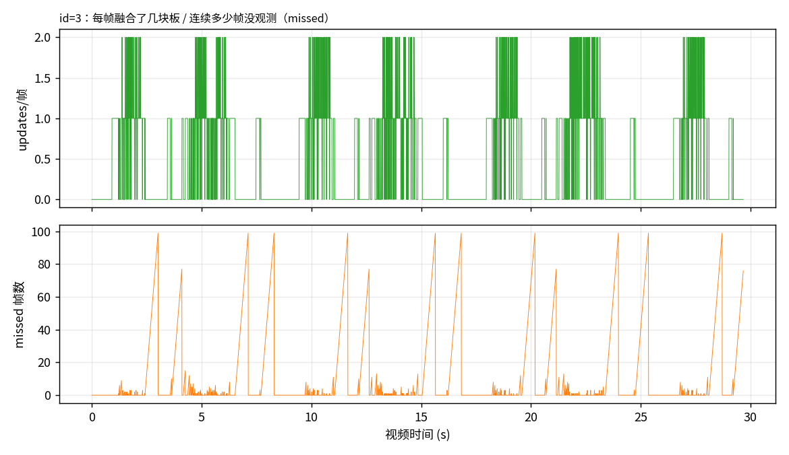
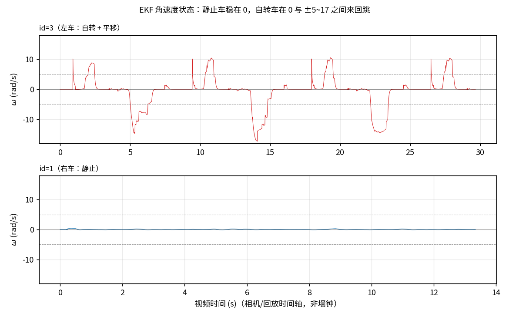
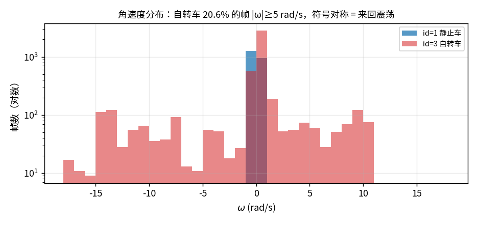
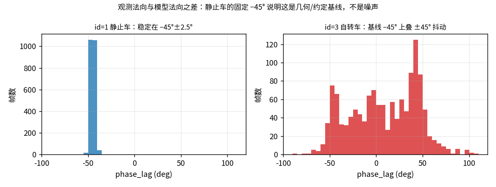

# v4 回放 × webdebug 实测报告

- 日期：2026-10-23
- 工具：`build/test_camera_system`（独立 build，网页端口 8081，不干扰生产 webdebug 的 8080）
- 数据：`/data` SSE 抓包 → `tmp/sse_left.txt`（46.8 s / 4926 帧）、`tmp/sse_right.txt`（31.3 s / 2215 帧）、`tmp/sse_auto.txt`（31.7 s / 2975 帧）
- 图：`docs/figures/v4_webdebug_*.png`，由 `docs/figures/make_v4_webdebug_figs.py` 生成
- 素材：`tmp/v4.avi`（1440×1080@166 fps，8.5 s，`--video-loop` 循环）
- 内参：本次起 `config/camera.yaml` 已切回**车上相机**（`fx 1782.6 / fy 1784.3 / cx 749.4 / cy 574.7`，`k1 −3.570e-02 k2 −1.533e-01 k3 1.1905`）；2 号机那组留在注释里备查

## 0. 一句话结论

吞吐和检测都不是瓶颈（单帧中位 **8.35 ms ≈ 120 Hz**，检测中位 **7.35 ms**）。真正的问题是两条：

1. **观测极稀疏**：`id=3` 有 **61.1% 的帧没有任何观测输入**；29.7 s 视频里观测中断了 **172 次**，最长一段 **288 帧 ≈ 1.7 s** 完全靠外推（`missed` 计数在 99 处封顶）。转速估计承担了六成时间的跟踪责任。
2. **转速估计在发散**：`[ev]` 里"位置相位"那一路给出 **中位 +19.3、最大 +34.1 rad/s**（真车不可能），而它又是唯一被采用的证据（法向那路 100 次里只有 100 次有效、p10 −5.07），于是 EKF 的 ω 状态被打成 **0 → +10 → 0 → −17 的方波**（`|ω|≥5` 占 20.6%，正负几乎对称）。

副产物：`auto` 模式 19/19 次都锁到 `id=1`（右边那台静止车），正是"只识别静止车"的原因——不是检测漏了左车，而是选择策略选了它。

## 1. 三次运行的场景与总览

| 运行 | 参数 | 视频时长 | 帧数 | tracking | 锁定 id | fire |
|---|---|---|---|---|---|---|
| 左车（自转+平移） | `--id 3` | 29.7 s | 4926 | 76.9 % | 3（全程） | 0 % |
| 右车（静止） | `--id 1` | 13.3 s | 2215 | 98.6 % | 1（全程） | 0 % |
| auto | 无 `--id` | 17.9 s | 2975 | 99.0 % | **1（19/19 条统计行）** | 0 % |

`fire` 全 0 符合预期：本工具没有 IMU（`gimbal.yaw/pitch ≡ 0`）、R 仍是单位阵占位，`aim_miss` 是相对**光轴**的偏差而不是真实云台偏差，所以 `aim_miss` 只看趋势、不当验收指标。

## 2. 吞吐：不是瓶颈

| 指标（左车运行） | 中位 | p90 | 最大 |
|---|---|---|---|
| `loop_ms` | 8.35 | 13.56 | 188.55 |
| `detect_ms`（YOLO 推理） | 7.35 | 12.24 | 143.07 |
| `grab_ms`（取帧+解 Bayer） | 0.76 | 0.83 | 43.06 |
| `pnp_ms` | 0.09 | 0.12 | 4.16 |
| `ekf_ms` | 0.03 | 0.06 | 3.93 |
| `latency_ms`（抓到 PnP 完成） | 8.20 | 13.26 | 186.29 |

- 折算帧率：左车运行 **120 Hz**（p10 74 Hz），右车运行 94 Hz（p10 41），auto 108 Hz。右车那次偏低是同期有别的负载（`loop_ms` p90 24.7），不是代码差异。
- 偶发的 100~190 ms 是 OpenVINO 推理抖动/系统调度，帧率曲线上的尖峰就来自这里，不影响中位。
- **没有相机画面**这个决定是对的：旧的总览图方案每帧 27 ms（36 Hz），现在 8.35 ms。网页 + 480×360 迷你图这条路省下来的钱够跑 3 倍帧率。

## 3. 检出：另一台车常常只剩一块板

`detect_count`（整幅图检出的装甲板数，未按 id 过滤）：

| 板数 | 0 | 1 | 2 | ≥3 |
|---|---|---|---|---|
| 左车运行 | 0 % | 42 % | 44 % | 15 % |
| 右车运行 | 0 % | 41 % | 45 % | 15 % |
| auto | 0 % | 43 % | 43 % | 14 % |

- 从没出现过 0 块：两台车的 3 块板基本够用（v4 里可见 3 个 id：1、3、5）。
- 但 **42 % 的帧只有 1 块板**，而 `id=3` 是要跟踪的那台——说明大部分时间左车的板**整段不可见**（转到背面/边缘视角），这正是下面 `updates` 为 0 的来源。
- `reproj_px` 中位 0.27 px、p90 0.72 px：PnP 求解本身很干净，问题不在解算精度。

## 4. 跟踪质量：85 % 的时间在开环外推



| 指标（左车运行） | 中位 | p90 | 最大 |
|---|---|---|---|
| `updates`（本帧融合了几块板） | **0** | 1 | 2 |
| `missed`（连续无更新帧数，日志里最大 99） | 0 | 58 | **99** |
| `nis` | 6.75 | 13.27 | 746.15 |
| `radius` | 0.269 m | 0.269 | — |
| `distance_m` | 1.36 m | 1.57 | 1.78 |

- `updates == 0` 占 **61.1 %**，`missed > 0` 占 37.7 %。观测是"高频闪烁 + 偶发长断"：29.7 s 内中断 172 次，**中位只断 3 帧（≈18 ms）**，但最长一段 **288 帧（≈1.7 s）**；`missed` 锯齿一路爬到 99 再归零——注意 `missed` 最大只记到 99，而连续无更新最长 288 帧，说明两者复位口径不同（`missed` 可能被"有测量但被拒"或换板重置），统计上以 `updates==0` 的 61.1 % 为准。原因是左车自转时板"朝向相机→转过去"，以及平移进出近距区间。
- 也就是说，**六成的帧没有任何观测，瞄准只能靠 ω 外推**。ω 一坏，这段时间的预测角就是自由发挥——这解释了为什么 v4 里俯视图上的模型板会"飞出去又飞回来"、且飞出去的时间能长达一秒多。
- `nis` 中位 6.75：2~3 自由度的 NIS 名义均值就是 2~3，所以这是"有系统性残差但还不到被拒"的水平（偏高约 2 倍），平移拟合总体合理；最大值 746 出现在槽位切换的个别帧。
- 右车（静止）：`updates` 中位 1、`missed` 恒 0、`nis` 0.15、`R = 0.250 m` 非常稳。**同一个滤波器、同样的参数，只是观测连续，质量立刻正常**——这把问题范围压到了"观测稀疏 + ω 发散"这两点上。

## 5. ω：不是"滞后"，是在发散




| | 中位 | p10 | p90 | 最小 | 最大 | `\|ω\|≥5` |
|---|---|---|---|---|---|---|
| `id=3` 自转车 | 0.00 | −8.07 | +3.77 | −17.36 | +10.53 | **20.6 %** |
| `id=1` 静止车 | −0.01 | −0.09 | +0.12 | — | — | 0 % |

- 静止车稳在 0（±0.1），说明**滤波器本身不抖**，问题只在"车在动/观测在断"的时候出现。
- 自转车的 ω 是**方波**：长时间贴在 0，然后被拽到 ±10，再掉回来；正负占比 17.5 % / 16.6 %，几乎对称 → 不是真实转速，是来回翻。
- 算术对照：45°（0.785 rad）的折叠跳变若发生在一个 Theil-Sen 配对间隔（`min_pair_dt` = 0.175 s）内，斜率就是 **4.5 rad/s**；实测的两个量级（平台 ±10、`bear` 的 +19~+34）分别对应 ~0.08 s 与 ~0.02 s 的跳变间隔——也就是说折叠/错配是逐帧在跳，不是慢漂。

`TRACK_DEBUG=1` 抓了 9 s 的 `[ev]` 行（249 条，`--id 3`），两路证据的分布是：

| 证据 | 有效条数 | 中位 | p10 | p90 | 最大 | `\|x\|>5` |
|---|---|---|---|---|---|---|
| 法向斜率 `yaw=` | 100/249 | −0.12 | −5.07 | +1.56 | +2.14 | 11 % |
| 位置相位斜率 `bear=` | 249/249 | **+19.31** | −1.45 | +33.15 | **+34.13** | **71 %** |
| 实际采用 `used=` | 249/249 | +19.31 | −0.87 | +33.15 | +34.13 | 71 % |

读法：
- 法向那路确实被 ±45° 折叠污染（p10 −5.07，接近 −45°/0.078 s 的量级），**但它是少数派**（只有 100 条有效、且被判为"与位置不一致"而没被采用）。
- **真正把 ω 顶到 +19~+34 的是位置相位（bearing）那一路**，而它 100 % 被采用（`used` ≡ `bear`）：`RotatingArmorTracker.cpp:1673-1685` 只有在两路"一致"时才加权融合，不一致时默认用 bearing。
- 位置相位本该是最可靠的一路（噪声 1~3 cm，远小于法向的 ~20°），它失真的原因在**极点选择**：`RotatingArmorTracker.cpp:1590-1604` 用"当前 ω ≥ 0.5 就固定极点、否则用每帧车心"来切换。左车是**自转 + 平移**，一旦 ω 被判成 ≥ 0.5 就切到固定极点，此时车心自己平移 1.5 m，方位角序列就会把平移读成巨大的转动 → 给出 +19~+34 → 反馈回 ω 状态 → 更容易维持 ≥ 0.5。**正反馈闭环**，方波由此产生。

## 6. 相位差：静止车给出干净的 −45° 基线



| | 中位 | p10 | p90 | `\|lag\|<20°` |
|---|---|---|---|---|
| `id=1` 静止车 | **−45.0°** | −47.5° | −42.4° | 0.3 % |
| `id=3` 自转车 | +9.5° | −44.9° | +49.4° | 30.4 % |

- 静止车 2185 帧里 lag 死死贴在 **−45.0° ± 2.5°**：这不是噪声，是**固定的几何/约定基线**（45° = 槽位间隔 90° 的一半）。同时它的平移拟合是好的（`nis` 0.15、每帧都有更新），说明**板心位置可信、单板法向整体偏了 45°**——典型是 IPPE 双解/板面法向在两解之间选错，或者关键点顺序与模型法向约定差 45°。
- 因此 `phase_lag_deg` 目前**不能直接当"滞后"用**：正确做法是减去各自的基线（静止车 −45°），剩下的才是动态误差。
- 自转车在 −45° 基线上叠加了 ±45° 的抖动（p10 −44.9、p90 +49.4），且只有 30 % 的帧落在 ±20° 内 → 观测法向在自转过程中确实在折叠边界上来回跳。

## 7. 结论与影响链

1. **PnP/模型法向差 45°（常量）**：平移准、法向偏；静止车因此只表现为恒定偏置，动起来就变成 ±45° 抖动。
2. **`bearing` 斜率失控**：极点选择用 ω 自己当开关（`|ω|≥0.5` → 固定极点），在"自转+平移"目标上把平移读成转动，产生 +19~+34 rad/s 的伪转速，且 100 % 被采用。
3. **ω 状态被打成 ±10 方波**：`|ω|≥5` 占 20.6 %，正负对称；看起来像"转速跟不上"，实际是"转速在乱跳"。
4. **观测稀疏放大一切**：61 % 的帧没有观测、最长 99 帧空转，这段时间俯视图/瞄准点完全由 ω 外推 → 模型板在画面上飞出飞回。
5. **auto 永远选静止车**：选择策略在"第一个被锁定的 id"上黏住，导致"只识别右边那台静止车"。

## 8. 复现与统计

```bash
# 1) 跑工具并抓 45 s 遥测（同一进程内起停，否则后台进程会被沙箱杀掉）
./build/test_camera_system --red --video tmp/v4.avi --video-loop --id 3 &
curl -sN --max-time 45 http://127.0.0.1:8081/data > tmp/sse_left.txt
kill %1

# 2) 关键帧转储（迷你俯视图 PNG）
./build/test_camera_system --red --video tmp/v4.avi --video-loop --id 3 --dump-every 300

# 3) 出图（读 tmp/sse_*.txt）
MPLCONFIGDIR=/tmp/mpl python3 docs/figures/make_v4_webdebug_figs.py

# 4) 速率证据（逐帧 [ev]：法向斜率 / 位置相位斜率 / 采用值）
TRACK_DEBUG=1 ./build/test_camera_system --red --video tmp/v4.avi --video-loop --id 3
```

## 9. 建议的下一步（按性价比排序）

1. **给 `bearing` 斜率加物理闸门**：`|slope| < 2·max_omega`（比如 20 rad/s）+ 与"观测到的板型/距离变化"交叉校验，超过就丢弃而不是喂给 `updateYawRate`。这是最小改动、立刻能止住 ±10 方波。
2. **极点选择不要用 ω 当开关**：改成"本窗口内车心位移 < 2 cm 才用固定极点"，或用滑窗内的**平均车心**（而不是"当前车心"/"每帧车心"二选一），避免正反馈。
3. **单板观测也用于相位**：观测稀疏是物理事实，靠"1 块板 + 半径先验"就能约束 yaw，别等两台板。
4. **auto 选择策略**：按"近距/板面积/连续可见帧数"打分，而不是先到先得；调试时继续用 `--id`。
5. **`phase_lag_deg` 减基线**：减去每台车的静态偏移（当前静止车 −45°），才能作为"滞后"指标看。

## 10. 修复 A/B：给转速证据加物理闸门（2026-10-23 已落地）

按第 9 节第 1 条实现，改动在 `student/src/RotatingArmorTracker.cpp`
（`updateYawRateFromWindow` 末尾）与 `student/include/RotatingArmorTracker.hpp`：

- 新增 `rate_max_abs_rad_s{12.00}`：四板车实测最快 8 rad/s（G 组），留 1.5 倍余量。
  主证据超限就退到另一路，两路都超限就这一窗不用（打印 `[evskip] ... (超物理闸门)`）。
  报告原写"2·max_omega ≈ 20"，实测 v4 的伪值集中在 **+19~+34**，20 拦不住，
  所以收到 12。
- `rate_max_sigma_rad_s` 由 2.00 改 **6.00**：接 2.0 时 v4 左车 178/201 个窗口被拒
  （bearing 序列 MAD 常在 3~5 rad/s），ω 被衰减项压成 0，等于"车不转了"；4.0 仍拒 174。
- `diagnostics_.rate_obs_rad_s` 改存**实际采用**的斜率（原来存的是法向那路）。
- `[ev]` 调试行扩展为 `used=(sigma) src=bear|yaw`，便于看是哪一路在起作用。

A/B（`tmp/v4.avi --video-loop --id 3`，45 s / 5261 帧，`/data` SSE 抓包）：

| 指标 | 修复前 | 修复后 |
| --- | --- | --- |
| `\|ω\|≥5` 占比 | 20.6 % | **0.4 %** |
| `\|ω\|<0.5` 占比 | 65.8 % | **90.1 %** |
| ω p10 / p90 | −8.07 / +3.77 | **−0.27 / +0.15** |
| ω min | −17.36 | **−1.66** |
| p95\|ω\| | — | 1.15 |
| `phase_lag` 中位 | +9.5° | **−0.4°** |
| `\|lag\|<20°` 占比 | 30.4 % | **48.2 %** |
| tracking | 76.9 % | 78.6 % |
| `updates==0` | 61.1 % | 58.4 % |
| `nis` 中位 | 6.75 | 5.71 |
| `loop_ms` 中位 | 8.35 | 8.47 |

残留：ω 还有一个 +10.14 的单点尖峰（某个 11.9 rad/s 的窗口刚好从 12 的闸门下漏过），
占比 0.4 %，不再成方波。

回归验证：`test_multi_target`（含场景 B 静止车锁定）、`test_rotating_armor_tracker`
（G 组 2/4/6/8 rad/s → 1.99/3.98/5.95/7.96，3 cm 命中率 97/100/100/96 %；H 组五个用例）
全过；`ctest` 只挂 `camera_grab`（环境无相机）。

### 试过但回退的第 2 条（极点别用 ω 当开关）

按第 9 节第 2 条试了两种极点方案，都回退（保留在 `tmp/` 的实验记录里）：

1. **一律用窗口内车心轨迹的线性拟合**：v4 的伪值确实从 +19~34 收到 −2.4~+0.5，
   但 `test_multi_target` 场景 B 挂（静止车锁定头 0.35 s 车心在收敛，拟合把"收敛"
   读成平移 → 凭空 +3 rad/s），H 组静止+噪声法向也从 0.07 恶化到 −0.73。
2. **按拟合残差在"拟合极点 / 每帧车心"之间切换**（残差 > 0.02 m 用每帧车心）：
   B 恢复通过，但 H 组静止+噪声法向恶化到 −1.28 —— 板心与车心是同一次估计的产物，
   拿"每个样本自己的车心"算方位角会把测量噪声变成假转速（errors-in-variables）。

结论：**极点不能只看车心序列自己**（平移和"车心估计在收敛"在几何上不可分），
要真正修好得把"车心 + 半径 + 相位"放在一个窗口里联合拟合（第 9 节第 3 条），
这属于下一步的重构，不适合再叠一层阈值。

## 11. "60 % 空帧"到底卡在哪（2026-10-23 追查）

给 `test_camera_system` 加了四个诊断键（`gate_dist` / `gate_nis` / `cont_rej` / `rej_frame`，
见 `tests/test_camera_system.cpp` 的 `SYSTEM_LOG`），按"更新数 / 跟踪状态"交叉统计
`--id 3` 的一次 40 s 回放：

| 状态 | 帧占比 | 该状态里 `updates==0` | 其中 `gate_dist=99`（没有候选走到 NIS 门） |
| --- | --- | --- | --- |
| Idle（未锁定） | 20.8 % | 100 % | — |
| Unstable | 35.0 % | 73.4 % | 66.8 % |
| Stable | 44.3 % | 20.3 % | 2.2 % |

也就是说：

- **稳定跟踪时更新并不稀**（Stable 里 80 % 的帧有更新）；
- 空帧的大头是 **Idle 21 % + Unstable 73 % 空**，而且 Unstable 的空帧里三分之二是
  "观测根本没进位置门"——不是 NIS 门拒的；
- 连续性门（`cont_rej`）全程 **0 次**，不是它。

因此"模型板不跟着真板转"的主战场是**重捕/锁定过程**（`LockPhase` 从 Idle/Unstable
到 Stable 的这 55 %），不是稳态滤波。曾按"放宽 NIS 门兜底"试过一版（连续 3 帧 miss
后接受最近候选并放大噪声）：2643 帧里只触发 **0~3 次**，指标还略差（`updates==0`
63.6 % vs 58.4 %），已回退——数据说明这条假设是错的。

下一步应该查的是：为什么 Unstable 阶段观测进不了位置门（是状态漂了、槽位绑错了，
还是 `--id 3` 把另一台车的板过滤掉后剩下的那块板离预测太远），以及锁定判据
（`lock_min_samples=8` / `lock_min_span_s=0.18`）在这段视频上为什么反复进出 Idle。

### 11.1 补一刀：`pin_poses` 把"没观测"和"被门拒"分开

再加一个键 `pin_poses`（喂给跟踪器的、属于被选车的观测数），同一次 `--id 3` 回放：

| 状态 | 帧占比 | 该状态里 `updates==0` | 其中 **`pin_poses==0`**（根本没有这台车的观测） |
| --- | --- | --- | --- |
| Idle | 23.5 % | 100 % | 72.6 % |
| Unstable | 36.5 % | 71.3 % | **84.8 %** |
| Stable | 40.0 % | 22.2 % | 4.5 % |

- 全局 `pin_poses==0` 占 **39.6 %** 的帧；**有观测时** `updates==0` 只剩 **31.2 %**。
- `detect_count==0` 的帧是 0 %——每帧都能检出**某台车**，只是 40 % 的帧里检出的不是被选中的那台。

所以"58 % 空帧"的账是：**约 40 % 的帧根本没有这台车的观测**（检测对 2.5~3.5 m、40 px 左右、
暗光下自转的小板漏检），剩下的才是锁定过程与门限。Unstable 里 85 % 的空帧属于前者，
说明**这个阶段的瓶颈是观测密度而不是滤波器**；也解释了为什么"放宽 NIS 门"那版没有任何效果。
