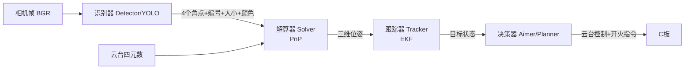
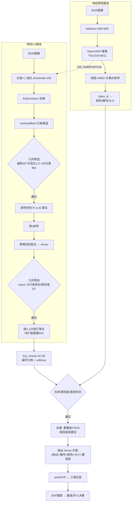

# 从灯条提取到装甲板识别：sp_vision_25 自瞄识别全流程解析

> 代码来源：[redstore666/sp_vision_25](https://github.com/redstore666/sp_vision_25)（同济大学 SuperPower 战队 25 赛季视觉框架，main 分支）
> 本文对应提取目录：`/workspace/sp_vision_25_autoaim/`，文中 `file:line` 均相对该目录。

---

## 0. 全景图：识别器在自瞄链路中的位置

自瞄软件是一个逐帧循环的流水线。入口程序 `src/standard.cpp:57-80` 的主循环清楚地展示了全链路：

```cpp
while (!exiter.exit()) {
  camera.read(img, t);                          // 1. 取图（带时间戳）
  q = cboard.imu_at(t - 1ms);                   // 2. 取该时刻云台姿态四元数
  solver.set_R_gimbal2world(q);                 // 3. 更新 云台→世界 旋转矩阵
  auto armors = detector.detect(img);           // 4. 【识别器】装甲板检测  ← 本文重点
  auto targets = tracker.track(armors, t);      // 5. 【估计器】EKF 跟踪
  auto command = aimer.aim(targets, t, cboard.bullet_speed);  // 6. 【决策器】瞄准+开火
  cboard.send(command);                         // 7. 发送指令给下位机
}
```



**识别器的职责**：输入一帧 BGR 图像，输出一个 `std::list<Armor>`——每个 `Armor` 携带 4 个像素角点、编号（1~5号/哨兵/前哨站/基地）、颜色（红/蓝）、大小（大/小）、置信度（`tasks/auto_aim/armor.hpp:80-121`）。

该仓库实现了**两条并行的识别路线**，由配置文件 `configs/standard3.yaml` 中的 `yolo_name` 字段切换（`tasks/auto_aim/yolo.cpp:16-30`）：

| 路线 | 实现 | 原理 | 当前状态 |
|---|---|---|---|
| 传统 CV | `tasks/auto_aim/detector.cpp` | 颜色阈值 → 轮廓 → 灯条 → 几何配对 | 保留，兼作神经网络的**角点二次矫正器** |
| 神经网络 | `tasks/auto_aim/yolos/`（YOLOv5/v8/11） | OpenVINO 推理四点关键点检测模型 | **当前上场方案**（standard3 默认 yolov5） |

---

## 1. 传统 CV 路线：灯条提取 → 装甲板识别

代码：`tasks/auto_aim/detector.cpp:33-120`（`Detector::detect` 主流程）。这是理解自瞄识别原理的最佳样本，共 8 个阶段。

### 1.1 图像预处理：灰度 + 全局二值化

```cpp
cv::cvtColor(bgr_img, gray_img, cv::COLOR_BGR2GRAY);                        // :37
cv::threshold(gray_img, binary_img, threshold_, 255, cv::THRESH_BINARY);    // :41
```

装甲板灯条是自带光源的高亮物体，在曝光 2.5ms、增益 16.9 的工业相机参数下（`configs/standard3.yaml:56-57`）显著亮于背景。全局阈值 `threshold: 150` 把灯条从背景中分离成白色连通域。

### 1.2 轮廓提取

```cpp
cv::findContours(binary_img, contours, cv::RETR_EXTERNAL, cv::CHAIN_APPROX_NONE);  // :46
```

`RETR_EXTERNAL` 只取最外层轮廓（灯条是实心亮斑）；`CHAIN_APPROX_NONE` 保留全部轮廓点——后续颜色判别需要逐点采样原图。

### 1.3 灯条候选生成：最小外接旋转矩形

```cpp
auto rotated_rect = cv::minAreaRect(contour);   // :52
auto lightbar = Lightbar(rotated_rect, lightbar_id);
```

`Lightbar` 构造函数（`tasks/auto_aim/armor.cpp:9-31`）从旋转矩形派生出全部几何量：

| 字段 | 计算方式 | 含义 |
|---|---|---|
| `top / bottom` | 四角点按 y 排序后取中点（:19-20） | 灯条上下端点 |
| `top2bottom` | `bottom - top` | 灯条方向向量 |
| `width` | 上两角点距离（:26） | 灯条宽度 |
| `angle` | `atan2(top2bottom)` | 灯条倾角 |
| `angle_error` | `abs(angle - π/2)` | 与竖直方向的偏差 |
| `length` | `norm(top2bottom)` | 灯条长度 |
| `ratio` | `length / width` | 长宽比 |

### 1.4 灯条几何筛选

`Detector::check_geometry(const Lightbar&)`（`detector.cpp:233-239`），三项全部满足才保留：

```cpp
angle_error < max_angle_error_        // 45°：灯条必须接近竖直
min_lightbar_ratio_ < ratio < max_lightbar_ratio_   // 1.5 ~ 20：长宽比
length > min_lightbar_length_         // 8px：过滤远处小亮点/噪点
```

参数来自 `configs/standard3.yaml:25-28`。

### 1.5 颜色判别

`Detector::get_color`（`detector.cpp:279-289`）——用轮廓点回原图采样，比较红色与蓝色通道累加值：

```cpp
red_sum += bgr_img.at<cv::Vec3b>(point)[2];   // R
blue_sum += bgr_img.at<cv::Vec3b>(point)[0];  // B
return blue_sum > red_sum ? Color::blue : Color::red;
```

红/蓝灯条在 BGR 空间差异巨大，这种"用轮廓点投票"的方式比均值法更抗反光干扰。

### 1.6 灯条排序与装甲板配对

```cpp
lightbars.sort([](const Lightbar& a, const Lightbar& b) { return a.center.x < b.center.x; });  // :63 从左到右
```

随后**两两组合**（`detector.cpp:67-84`）：左侧灯条 × 右侧灯条，同色才配对：

```cpp
for (auto left = lightbars.begin(); left != lightbars.end(); left++)
  for (auto right = std::next(left); right != lightbars.end(); right++) {
    if (left->color != right->color) continue;      // 颜色必须一致
    auto armor = Armor(*left, *right);
    ...
  }
```

`Armor` 传统构造函数（`armor.cpp:34-56`）计算装甲板级几何量：

| 字段 | 计算方式 | 用途 |
|---|---|---|
| `points[4]` | left.top, right.top, right.bottom, left.bottom | 供 PnP 使用的四个角点 |
| `ratio` | 两灯条中心距 ÷ 长灯条长度 | 区分大/小装甲板（大≈3.2，小≈2.2） |
| `side_ratio` | 长灯条 ÷ 短灯条 | 真实装甲板两灯条应几乎等长 |
| `rectangular_error` | 灯条方向与中点连线的夹角偏离 π/2 的程度 | 装甲板是矩形，灯条应垂直于两灯条连线 |

### 1.7 装甲板几何筛选

`Detector::check_geometry(const Armor&)`（`detector.cpp:241-247`）：

```cpp
min_armor_ratio_(1) < ratio < max_armor_ratio_(5)   // 排除过近/过远的不合理形状
side_ratio < max_side_ratio_(1.5)                   // 两灯条长度差 < 50%
rectangular_error < max_rectangular_error_(25°)    // 近似矩形
```

这一步过滤掉"两根相近竖直亮条"的误配（如场地灯带、队友机甲边缘）。

### 1.8 装甲板"识别"：图案提取与编号分类

几何约束只能证明"这是一个装甲板形状"，要回答"它是几号、敌我、大小"还需两步：

**第一步，截取图案 ROI**（`detector.cpp:291-309`）。装甲板中心数字区域在两灯条之间，通过物理尺寸比例外推：沿灯条方向把灯条中心向外延长 1.125 倍——

```cpp
// 1.125 = 0.5 * armor_height / lightbar_length = 0.5 * 126mm / 56mm
auto tl = armor.left.center - armor.left.top2bottom * 1.125;   // :294-295
...
auto roi = cv::Rect(roi_tl, roi_br);
return bgr_img(roi);      // armor.pattern
```

即用"灯条长 56mm、装甲板高 126mm"的规则尺寸，把仅含灯条的轮廓信息扩展成完整装甲板区域。

**第二步，神经网络分类**（`tasks/auto_aim/classifier.cpp:17-59`）。`tiny_resnet.onnx` 是一个 32×32 灰度输入、9 类输出的小网络：

1. 图案转灰度，等比缩放进 32×32 画布（ letterbox ）；
2. `cv::dnn::blobFromImage` 归一化到 [0,1]；
3. 前向推理 → softmax → argmax；
4. `armor.name = ArmorName(label_id)`，`armor.confidence` = 最大概率。

9 个类别：`one/two/three/four/five/sentry/outpost/base/not_armor`（`armor.hpp:27-40`）。

**第三步，编号校验**（`check_name`，`detector.cpp:249-261`）：`name != not_armor && confidence > min_confidence(0.8)`。置信度不足的图案会**自动保存**到 `patterns/` 目录（:255）——这是为分类器迭代积累难例的数据飞轮。

**第四步，大小判定与一致性校验**（`get_type`，`detector.cpp:311-338`）：

- `ratio > 3.0` → 大装甲板；`ratio < 2.5` → 小装甲板；
- 介于两者之间时按编号判定：1号英雄、基地 → 大；其余 → 小；
- `check_type`（:263-277）再校验"小装甲板不能是 1号/基地"等规则，异常图案同样保存待分析。

### 1.9 去重与输出

一个装甲板的两个灯条可能同时参与构成相邻装甲板（误检或重叠），`detector.cpp:87-115` 做两两去重：

- **共用同一侧灯条**（重叠）：保留 ROI 面积小的；
- **首尾相连**（一个装甲板的左灯条 = 另一个的右灯条）：保留置信度高的。

最后 `armors.remove_if(duplicated)`，debug 模式下 `show_result` 可视化全部中间结果。

### 1.10 一个预留的精度增强：PCA 灯条角点矫正

`lightbar_points_corrector`（`detector.cpp:386-489`，参考深圳大学 FYT2024_vision）对灯条 ROI 做 PCA 求对称轴、沿轴搜索亮度跳变点精确定位端部。该函数在当前主流程中**未启用**（`detector.cpp:179` 处被注释），可作为提高 PnP 精度的备选优化。

---

## 2. 神经网络路线：YOLO 四点检测（当前上场方案）

代码：`tasks/auto_aim/yolos/yolov5.cpp`、`yolo11.cpp`、`yolov8.cpp`，由 `YOLO` 工厂类（`yolo.cpp:11-31`）按配置实例化。

### 2.1 前处理

```cpp
// yolo11.cpp:57-99
if (use_roi_) bgr_img = raw_img(roi_);                    // 可选 ROI 裁剪（限定搜索区域，提速）
cv::resize(bgr_img, input(roi), {w, h});                 // letterbox 等比缩放进 640×640
ov::Tensor input_tensor(ov::element::u8, {1, 640, 640, 3}, input.data);   // u8 直接推理，省去归一化拷贝
infer_request.infer();                                   // OpenVINO，LATENCY 模式，可选 GPU
```

### 2.2 后处理：解析输出张量

以 **YOLO11** 为例（`yolo11.cpp:102-176`，`class_num_ = 38`，`score_threshold_ = 0.7`，`nms_threshold_ = 0.3`）：

```
输出行布局（transpose 后每行一个候选）：
[0:4)    xywh       检测框中心宽高
[4:42)   38 类分数  颜色×编号×大小 组合（armor_properties 表，armor.hpp:52-64）
[42:50)  4 个关键点  装甲板四角像素坐标
```

流程：阈值过滤 → 反算 box → 恢复 4 个关键点（÷scale 还原到原图尺度）→ `sort_keypoints`（`yolo11.cpp:209-235`，按 y 再按 x 排序统一为 **TL→TR→BR→BL** 顺序）→ NMS → 构造 `Armor`。

YOLOv5 的输出布局不同（`yolov5.cpp:110-157`）：col 8 是 objectness（sigmoid 后阈值 0.7），cols 9-13 是颜色 one-hot（4 类），cols 13-22 是编号 one-hot（9 类），cols 0-7 是 4 个关键点（按 0,6,4,2 的顺序取出拼成 TL,TR,BR,BL）。

### 2.3 从 class_id 到语义属性

`Armor` 神经网络构造函数（`armor.cpp:59-97`）通过 `armor_properties[class_id]` 三元组表一步得到颜色、编号、大小——**编号和大小不再依赖比例阈值判断**，这是神经网络路线召回率更高的根本原因。几何量（ratio、rectangular_error 等）仍从关键点计算，供后续筛选与参考。

### 2.4 与传统方法的融合：角点二次矫正

standard3 配置中 `use_traditional: true`（`configs/standard3.yaml:12`）。YOLO 给出关键点后，调用传统检测器的 ROI 版本（`detector.cpp:122-231`）做精修：

```cpp
if (use_traditional_) detector_.detect(*it, bgr_img);   // yolov5.cpp:184
```

其逻辑（`detector.cpp:124-230`）：把 YOLO 的四点按灯条方向外扩构造装甲板 ROI → 局部二值化 → 提取灯条 → 在 ROI 内找到分别距离 (tl,bl) 和 (br,tr) 最近的左/右灯条 → 距离和 < 15px 则认为矫正成功，用传统灯条的 top/bottom 端部**替换 YOLO 关键点**。神经网络管"找得到"，传统视觉管"定得准"——这是两路线融合的精华。

---

## 3. 识别之后：从像素到火控指令（链路衔接）

识别输出只是开始，后续模块与之衔接：

| 模块 | 代码 | 职责 |
|---|---|---|
| 解算器 | `solver.cpp:55-88` | `solvePnP(SOLVEPNP_IPPE)`：用大装甲板 230×56mm / 小装甲板 135×56mm 的 3D 模板匹配 4 个像素角点，求装甲板在相机/云台/世界坐标系下的位置与姿态；`optimize_yaw`（:196-218）在 ±70° 范围以 1° 步进搜索最小重投影误差的 yaw，解决装甲板平面朝向的多解问题 |
| 跟踪器 | `tracker.cpp:31-96` | 按敌方颜色过滤 → 按到画面中心距离和优先级排序 → EKF 整车状态估计 → 发散/NIS 收敛检测，丢失目标时状态机回 `lost` |
| 决策器 | `aimer.cpp` / `planner/` | 计算提前量（子弹飞行时间+各环节延迟约 15ms）、瞄准位置、开火时机；25 赛季创新采用 TinyMPC 轨迹规划器（`planner/tinympc/`，求解 <1ms） |

---

## 4. 关键参数速查（configs/standard3.yaml）

**传统路线阈值**

| 参数 | 值 | 作用 |
|---|---|---|
| `threshold` | 150 | 二值化灰度阈值 |
| `max_angle_error` | 45° | 灯条最大偏角 |
| `min/max_lightbar_ratio` | 1.5 / 20 | 灯条长宽比范围 |
| `min_lightbar_length` | 8 px | 灯条最短长度 |
| `min/max_armor_ratio` | 1 / 5 | 装甲板长宽比范围 |
| `max_side_ratio` | 1.5 | 两灯条长度差上限 |
| `max_rectangular_error` | 25° | 矩形度上限 |

**神经网络参数**

| 参数 | 值 | 作用 |
|---|---|---|
| `yolo_name` | yolov5 | 检测模型选择（yolov5/yolov8/yolo11） |
| `min_confidence` | 0.8 | 分类置信度阈值 |
| `use_traditional` | true | 启用传统角点二次矫正 |
| `use_roi` / `roi` | false / (420,50,600,600) | ROI 裁剪开关与区域 |
| `device` | GPU | OpenVINO 推理设备 |

**3D 尺寸常量**（`solver.cpp:12-14`）：灯条长 56mm；大装甲板宽 230mm；小装甲板宽 135mm。

---

## 5. 总结：全流程一图流



**核心设计思想回顾**：

1. **先验几何 + 学习分类的分工**：灯条/装甲板的形状约束用可解释的几何规则（角度、比例、矩形度），"这是几号"用神经网络——传统路线如此，YOLO 路线则把关键点定位也交给网络，但保留传统方法做角点精修；
2. **数据飞轮**：所有置信度不足、类型矛盾的图案自动落盘（`patterns/`），直接服务于下一轮模型迭代；
3. **规则尺寸驱动**：1.125 倍外推、230/135mm 装甲宽、56mm 灯条长——RoboMaster 的标准化装甲板尺寸是全部几何算法的隐含前提；
4. **模块化解耦**：识别器只管"看到什么"，位姿解算、跟踪、决策各自独立，通过 `Armor`/`Target` 数据结构衔接，每模块都有独立测试程序（`tests/`）支持离线回放调试。
