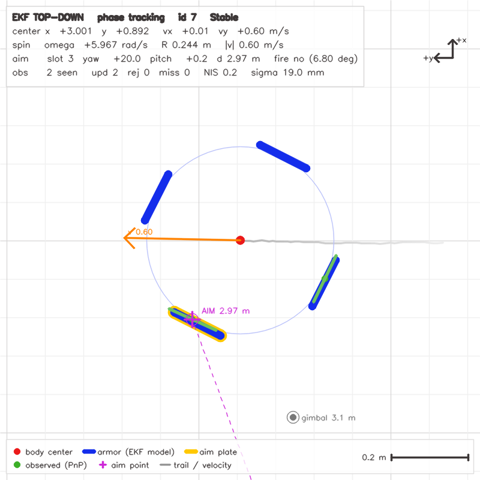
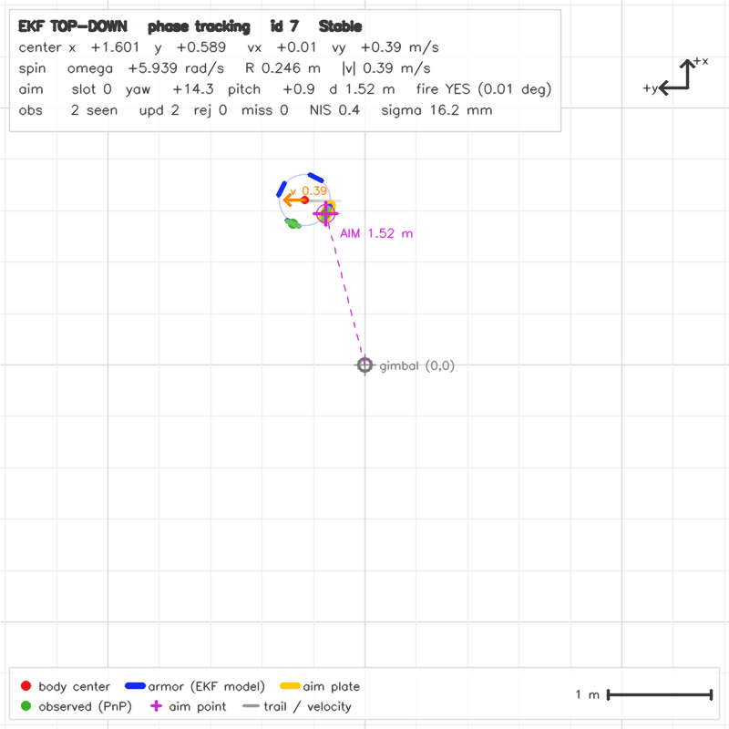
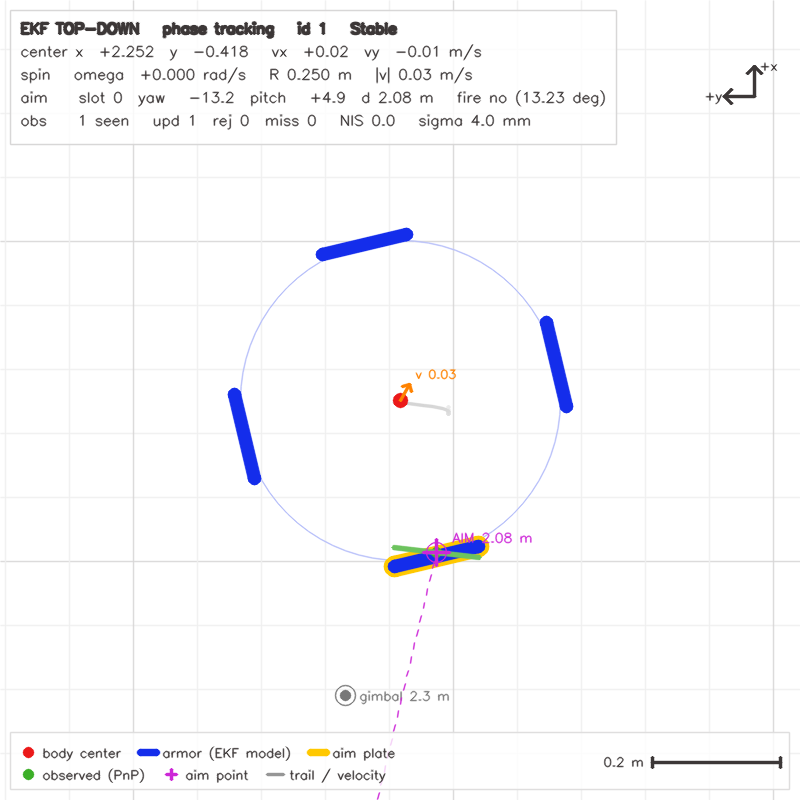
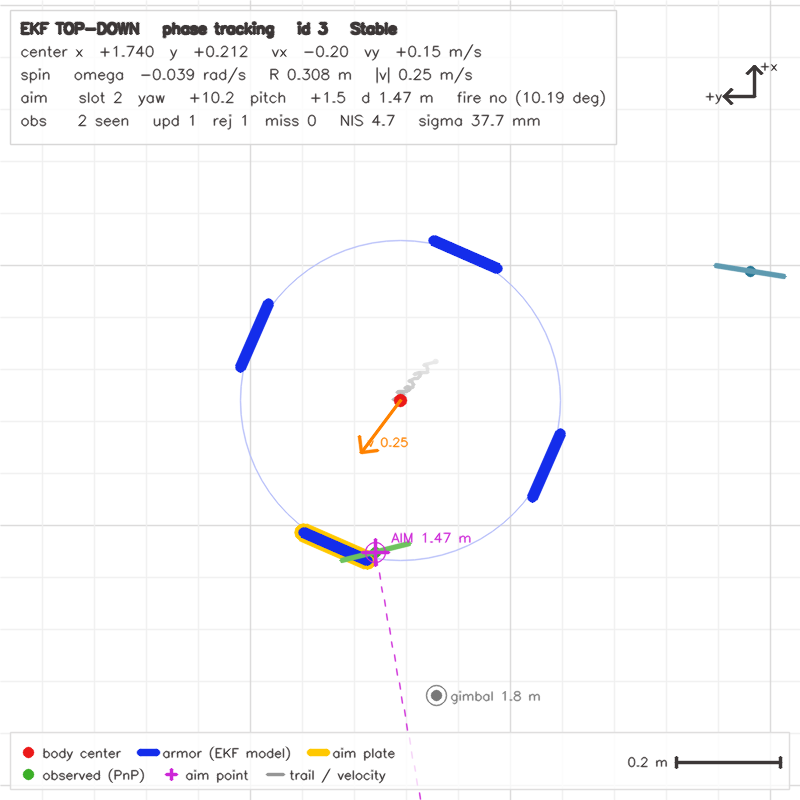

# 视觉组大作业：测试与调试记录

> **路线说明（2026-10-14）**：装甲板检测已从传统视觉（HSV 掩码 + 灯条提取/配对 +
> 数字分类）切换为**神经网络四点检测**——YOLO 关键点模型直接输出装甲板四个角点，
> 用 OpenVINO 推理（`student/ArmorDetectorNet.*`）。本文第五、六章记录的传统管线
> 调试过程，其代码与专用工具（test_bar_fit 等）已随切换移除，作为方法与教训保留；
> 当前有效实现的说明见 `models/README.md` 和 `student/src/StudentTasks.cpp`。

---

## 一、现状

自瞄视觉链路：**相机取流 → 装甲板检测 → PnP 位姿解算 → EKF 跟踪预测**。

| 环节 | 状态 | 总结 |
| --- | --- | --- |
| 相机取流 | ✅ 完成 | 断线重连、退出释放、日志分级都处理了 |
| 相机标定 | ✅ 内参完成 / ⚠️ 外参待填 | 2 号机 MATLAB 标定，均值重投影误差 0.07px |
| 装甲板检测 | ✅ 神经网络四点检测 | YOLO 直接出四角点，实拍检出率 100% |
| PnP 解算 | ✅ 完成 | 含平面目标"孪生解"消歧，重投影误差 1.6~1.8px |
| EKF 跟踪 | ✅ 完成 | 9 维旋转车体模型，两段式锁定，NIS 关联，遮挡外推与重锁；`ekf_*` 6 项 ctest 全绿 |

---

## 二、配置运行

```bash
# 配置（需要 OpenVINO 运行时，见 环境依赖.md）
cmake -S . -B build -DOpenVINO_DIR=<python>/lib/python3.X/site-packages/openvino/cmake
cmake --build build -j

ctest -E camera_grab                       # 单元自检（scaffold/CLI）
./build/test_detect 图片.png --red          # 单图检测（--save 存叠加图）
./build/test_batch 图片目录 --red           # 批量检出率评估
./build/test_solve 图片.png --red           # 检测→PnP 全链路
./build/test_camera_live --red              # 实时相机（需接相机）
```

环境：C++17 / CMake / OpenCV 4.5.4 / Eigen / MVS SDK / OpenVINO 2026.4.1（pip），无 ROS2。
硬件：海康 MV-CA016-10UC 工业相机（1440×1080），2 号机。

---

## 三、相机取流

`get_pic()` 负责相机的一次性初始化、取流、像素格式转换和异常处理。这一章全是踩坑记录，五个问题一句话版：

1. **退出不释放句柄** → 相机被占用要拔插 USB。加了 `release_camera()`，退出前成对释放。
2. **初始化失败不重试** → 首次没插好就永远"未连接"。改为只有初始化成功才置标志位，且每 30 帧才尝试一次。
3. **错误日志刷屏** → 给 `init_camera` 加 `verbose` 参数，首次详报、后续静默。
4. **声明与定义不一致** → 默认参数只能写在头文件里。
5. **断线不重连** → 重置状态时漏清了一个计数器，偶发抖动被累计成永久故障。

---

## 四、相机标定

最终提交的是 **2 号机 + MATLAB Camera Calibrator** 的结果（约 30 张有效视图）：

```
fx=1806.2  fy=1804.7  cx=738.8  cy=526.3
畸变 [k1,k2,p1,p2,k3] = [-0.0761, 0.1522, 0, 0, 0]
```

已填入 `config/camera.yaml`。**外参（相机→云台）还没有**，文件里是占位单位阵：
单位阵能通过 `valid()` 的正交性检查，程序会正常启动，但直接把单位阵当外参等于把
OpenCV 光学系当成云台系。`armor_solve` 现已检测占位值并补上"光学系 → 云台系"的
固定旋转（`rotationCameraToGimbal()`，首帧打印警告），回归测试在 `ekf_pipeline`。

调相机前用旧 07 号机做了三轮 OpenCV 标定练手，得到几条有用的结论：

- **"角点全部检出"不等于标定质量好**。要看 RMS、子集拆分稳定性、bootstrap 不确定度；
- 覆盖不够时高阶畸变估不准，改用 k1 受限模型是**数据给出的结论**（自由 5 参数只省 0.0017px，k2/k3 抽样符号乱跳），不是妥协；
- 柔性标定板手持会弯，残差场呈平滑曲面，把 k1 从 -0.051 污染到 ≈0——**板子必须垫硬**；
- 换相机必须重新标定（新旧机 fx 差 0.8%，符合同型号一致性）。

---

## 五、装甲板检测

### 5.1 当前方案：神经网络四点检测

YOLO 关键点检测模型（sp_vision_25 的 yolov5，OpenVINO IR）直接回归装甲板四个角点，
同时输出颜色、编号、大小。完整 spec 在 `models/README.md`，这里只说结论：

- **检出率**：实拍视频抽帧，红 64/64、蓝 141/141，**100%**；
- **速度**：CPU 单帧推理 13~25ms，相机 30fps 预算内余量充足；
- **质量**：`test_solve` 显示距离帧间抖动约 1cm，PnP 重投影误差 1.6~1.8px；
- 输出直接就是 PnP 需要的 TL,TR,BR,BL 四角点，编号/大小/颜色一步到位，不需要额外分类器。

**已知短板**：个别倾斜角度下四角点会抖。这是单帧回归的固有现象（网络输出没有时域
约束），目前靠下游 EKF 平滑。后续可选：角点级轻量时序滤波，或复刻 sp_vision_25 的
"NN 检出 + 局部灯条精修"混合方案。

### 5.2 历史：传统视觉路线做对了什么

传统管线（HSV 掩码 → 灯条提取 → 灯条配对 → 数字分类）的调试历时最久，代码虽已移除，
过程中验证过的结论仍然有效：

**实拍检出率从 0/18 修到 18/18**（旧机素材）。做法是给每一层加统计做"漏斗定位"：
15/18 死于灯条过滤，1/18 死于配对，2/18 死于裁剪分类。**先定位再调参**——最初猜的
"配对约束太严"被数据否决（它只杀了 1 张），盲目放宽阈值救不了任何案例。

关键问题与解法：

| 问题 | 解法 |
| --- | --- |
| LED 过曝，灯条在掩码里成"空心环" | 过曝白芯（V≥230, S≤80）反而是更真实的灯条几何，用它修宽度和方向 |
| 空心环填补 | floodFill 补闭合孔洞，不要无限加大形态学核 |
| 3×3 开运算"假 bug" | 会抹掉白芯细段，让白芯修复失效——**能跑的代码不要随便改** |
| 数字区被红色光晕污染，误判 9neg | 灰度改 `min(B,G,R)` 通道：彩色必有一个低通道被压暗，灰白数字不受损 |
| 假碎片放大后"脑补"成数字 | 极小裁剪（<16px 或面积<1200）直接拒绝，不进分类器 |
| 假装甲板挤掉真装甲板 | 冲突消解按**分类置信度**排序，不按几何近似度（几何近的假对会赢） |
| 斜切平行四边形假对 | 新增"上下连线应垂直于灯条"条件（夹角 ≤25°） |

**数字分类模型**（历史，2026-10-15 已随路线切换删除模型文件与测试）：YOLO26n-cls 微调，
按 md5 去重划分后验证集 top1=100%（1775 张），ONNX/OpenCV DNN/ctest 全链路验证通过。
注意训练裁片是"白字黑底、紧贴数字"，推理时裁剪数字占比 <10% 会被高置信度误判为负类。

**回放工具踩过最大的坑**：交互式回放每轮把检测框画进 `frame`，下一轮再检测这张
被画过的图——坐标轴红线、绿框、UI 文字全被当成灯条，制造海量假检。修复：检测只读
原始帧，一切绘制只发生在克隆图上。

---

## 六、PnP 位姿解算

按大小装甲板分别建 3D 物点（小 135×57mm / 大 230×57mm），`solvePnP(IPPE)` 解算，
重投影误差 >6.0px 的观测拒绝。阈值 6.0 是按误差分布定的（正常批次 P95≈4，坏批次
P50≈8），不是拍脑袋。

**平面目标的"孪生解"问题**（坐标系蓝轴来回翻转的根因）：平面装甲板的 IPPE 有两个
镜像位姿，重投影差只有 0.15~2.3px、位置差 ≤8.5mm，但装甲板 yaw 差 10~30°。逐帧按
"误差小者"独立选，亚像素噪声就能让朝向来回翻。显示端已用时域一致消歧
（`solveArmorPoseDisambiguated`：误差差 >3px 以误差为准，否则取与上一帧法向最近
的解）；`armor_solve` 的 yaw 观测抖动留给 EKF 阶段处理。


---

## 七、当前状态与验收结果

- ✅ 相机取流稳定（断线重连、热插拔、退出释放）；
- ✅ 内参入配置（2 号机，MATLAB，均值误差 0.07px）；⚠️ 外参待提供；
- ✅ 检测：实拍红蓝各 100% 检出，单帧 18~25ms（640x640 输入）；默认已切
  `640x480`（同比例、计算量 -25%，实拍 5 帧 A/B 距离差 ≤0.8%、角点差 1~4px），
  `RMV_DET_SIZE=640` 可回到正方形输入；`512x384` 再快 43% 但远距召回明显下降；
- ✅ PnP：重投影误差 1.6~1.8px，距离帧间抖动 ~1cm；
- ✅ ctest 8/8 通过（camera_grab 需接相机，本机跳过）；
- ✅ EKF：见 `docs/EKF设计说明.md` 与 `docs/实验报告.md` §4；
- ⚠️ 个别倾斜角度角点抖动（见 5.1），现由 EKF 平滑；
- ⚠️ 外参数值到位后填 `camera.yaml` 并置 `calibrated: 1`。

### 阶段规划：先走完大流程，再做精细优化

当前的定位是：检测模型（sp_vision_25 的 yolov5）已满足验收要求，
**模型重训不作为本阶段的阻塞项**。节奏分两段：

1. **先保证大流程走完**（当前阶段）：相机联机实跑 → 外参标定填入 →
   EKF 跟踪实现 → 全链路（取流→检测→PnP→EKF→通信帧）实机验收。
2. **再做精细优化**（大流程验收后）：模型针对性重训（yolo26n/yolo11n
   pose，伪标注 + 人工修正，专攻远处小目标与倾斜角度）、INT8 量化、
   比赛机 GPU、远近双模型自适应等。这些是"好不好"的改进，
   每一项都按检出率 + 角点偏差 + 重投影三项指标 A/B 后决定是否合入。

理由：重训要解决的是精度上限问题，而 EKF 未实现时系统还没有完整闭环，
拿不到端到端的验收数据；先把流程跑通、拿到真实场景的全链路表现，再决定模型往哪个方向训。

**下一步（按序）**：① 相机联机实跑 `test_camera_live`（含 fps_cam/fps_nodisp
口径确认）；
② 外参标定与 `camera.yaml` 填写；
③ ~~EKF 模型设计与实现~~（已完成）；
④ 全链路实机验收；⑤ 才进入精细优化段。

---

## 八、EKF 跟踪与预测的测试

任务 4 的测试分三层，全部是合成真值驱动（不需要相机和模型文件）：

| ctest 名 | 可执行文件 | 覆盖 |
| --- | --- | --- |
| `ekf_model_unit` | `test_rotating_armor_model` | 模型数值、解析雅可比 vs 中心差分、过程噪声对称半正定 |
| `ekf_model_convergence` | `test_rotating_armor_convergence` | 单槽合成真值 300 帧收敛、默认过程噪声防回退、历史默认值诊断行 |
| `ekf_init_contract` | `test_rotating_armor_ekf_init` | 生命周期/非法输入/reset/dt 边界、有先验 vs 无先验收敛对比、8 个噪声种子、纯外推判别 |
| `ekf_aim_geometry` | `test_aim_geometry` | 云台系/世界系约定、正交性、往返一致、极角与相位互换 |
| `ekf_tracker` | `test_rotating_armor_tracker` | 锁定/收敛/换板、静止目标开火、遮挡外推、超时清空、离群拒绝、换目标重锁、预测时域含实测延迟 |
| `ekf_pipeline` | `test_ekf_pipeline` | 观测 → `ekf_predict` → `applyPrediction` → 64 字节帧，安全输出不变量 |

```bash
./build/test_rotating_armor_convergence   # 打印收敛表
./build/test_rotating_armor_ekf_init      # 打印初始化路径对比与外推判别
./build/test_rotating_armor_tracker       # 打印六个场景的结果
./build/test_ekf_pipeline                 # 打印 crc 计数与逐帧协议字段
```

真数据回放用 `tests/test_camera_playback`（不在 ctest 里，需要视频文件）：

```bash
./build/test_camera_playback tmp/v4.avi --red --ekf --headless                 # 汇总
./build/test_camera_playback tmp/v4.avi --red --ekf --headless --only-id 3     # 只看某编号
./build/test_camera_playback tmp/v4.avi --red --ekf --headless --trace         # 逐帧诊断
./build/test_camera_playback tmp/v4.avi --red --ekf --csv build/v4.csv         # 导出观测/EKF
```

俯视图（上帝视角）调试：把 EKF 结果画成一张 800x800 的图（风格见 `tmp/example.jpg`），
用来一眼看出"状态和实测板对不对得上、瞄准点在哪、开火判据还差多少度"：

```bash
./build/test_ekf_viewer                                   # 合成旋转目标，窗口实时看
./build/test_ekf_viewer --no-show --out build/topdown_demo  # 无显示环境：逐帧导出 PNG
./build/test_ekf_viewer --world --range 1.6 --ppm 200      # 固定原点（云台）视图
./build/test_camera_playback tmp/v4.avi --red --ekf --topdown            # 真视频 + 俯视图窗口
./build/test_camera_playback tmp/v4.avi --red --ekf --headless \
        --topdown-out build/topdown_v4                    # 真视频：俯视图逐帧落盘
```

图上元素：红点 = EKF 车体中心；四根蓝条 = 用 `body_yaw/R` 推出来的模型装甲板；
黄边 = 当前瞄准板；绿点/绿条 = 本帧 PnP 实测板心（和蓝条错开就是视觉抖动或状态偏差）；
品红十字 + 虚线 = 预测瞄准点与从云台原点出发的瞄准射线；灰虚线 = 云台当前光轴，
两根线的夹角就是 `fire_allowed` 里的 yaw 误差。左上角打印状态机、中心/速度/角速度/R、
瞄准槽位与距离、观测数/NIS/观测噪声，底部是图例与比例尺（`--world` 固定原点时
按 `--ppm` 缩放，目标超出视野会自动缩小；跟随模式则按车体大小自动缩放）。

实现上分成两层：`include/TopDownView.hpp` + `src/TopDownView.cpp`（只读
`TrackerDiagnostics`/`PredictionResult`/`EKF State`，不碰跟踪逻辑，库名 `topdown_view`），
两个调用方分别是 `tests/test_ekf_viewer.cpp`（合成真值）和 `test_camera_playback --topdown`。
截图：




坐标映射只有一处：`px = w/2 - (wy-cy)*ppm`、`py = h/2 - (wx-cx)*ppm`，即画布向上 = +x（前方）、
向左 = +y（左方），车体自转在图上呈逆时针。

`--trace` 每帧打印 `phase`（0=Idle/1=Collecting/2=Tracking）、锁定编号、累计接收
更新数、本帧拒绝数、丢帧数、重锁次数、状态量 `omega/R/yaw`、最近 NIS、
`why`（最近一次拒绝原因）与 `stab`（本帧 `Stable/Unstable` 的判定理由：
`stable`/`stale`/`few_updates`/`phase`）。调 EKF 时先看 `stability`，
它比"板残差"更能指出问题在观测还是状态。

几个与实拍相关的默认值（都在 `TrackerConfig`）：`bootstrap_updates=10`（锁定期前
10 次更新不做 NIS 否决）、`stale_after_s=0.10`（新鲜度按秒判，不按帧数）、
`contradiction_check=false`（声明反驳在真数据上会误杀，默认关）。

### 转速自判（`omega` 由数据决定，不靠调用方声明）

早期版本要求调用方在 `EkfInitPrior::spin` 里声明 `Static` / `Spinning`，理由是
"静止目标的 `omega=0` 从数据里学不出来"。实拍证明反例：v4 静态目标上法向在
±45° 折叠边界附近来回翻，解缠后是每帧 +5° 的锯齿，任何"逐帧微分"都会给出
假高速旋转（实测最小二乘 16 rad/s、Theil-Sen −10 rad/s），模型整块板跟着转，
就是"圆心偏了"的观感。现在改成三件事：

1. **窗口斜率**：取最近 `rate_window_s=0.35 s` 的样本，法向按 `2π/N` 折叠解缠，
   斜率用 Theil-Sen（点对斜率中位数，对 ≤30% 野值免疫），误差用 MAD（不低于
   `rate_sigma_floor_rad_s=0.15`）。超过 `rate_max_sigma_rad_s=2.0` 直接弃用。
2. **换板续接**：最近邻关联失败时，若观测与上一采样法向差是 `2π/N` 的整数倍
   （四块板共享车体朝向），就接上窗口。快速自转（8 rad/s，每 30 帧换一块板）
   靠这一条保活；v4 的斜置副板法向差 26°，不会被误接。
3. **双路证据 + 反证据**：同一窗口再算一路"板相对车心的方位角"斜率（每个样本
   用它自己的车心，平移不产生方位角变化）；两路差超过 `max(1.5, 0.5|slope|)`
   就当这窗说不清转速、不更新；超过 `rate_decay_after_s=0.6 s` 拿不出斜率，
   就喂一次 `omega=0` 的弱伪量测（sigma 2.0），把 omega 按住在 0。

`--trace` 里的 `wobs=±n=` 现在写成 `n=本帧斜率样本数/窗口样本数`，`rate_window_samples=0`
表示这一帧根本没有可续接的观测（不是拟合失败）。`mode=static/trans/spin` 是
`TrackerDiagnostics::motion`：每帧从状态量读出来的运动类型（`|omega| >= static_rate_rad_s`
→ spin；否则 `|v| >= motion_translating_speed_m_s` → trans；否则 static），
俯视图 HUD 第三行也会显示同一个词。它只是"现在认为车在干什么"，说明可信度的是
`rate_obs_sigma_rad_s`，两者别混。回归测试见
`test_rotating_armor_tracker` 的 G 组（2/4/6/8 rad/s）与 H 组（静止/平移/慢转，
判据是"omega 落在真值附近"而不是"命中率"）。

**原理边界**：只给图像、不给云台 IMU 时，"镜头被人手晃动"与"目标自转"在世界系里
是同一个转动，任何估计器都无法区分。v1（手持、近处一台车+远处一台车）实测：
修前 omega 发散到 10 rad/s，修后稳定在 |omega| ≲ 0.6 rad/s；残差 0.08 m 中位主要
来自抖动本身，上实车接了云台角就自动消失。真要再压，就得用画面里另一台静止车
当参照做共模补偿，或直接信 IMU。

三条从这个环节得到的教训（数值见 `docs/实验报告.md` §4.6）：

1. **单帧拟合残差不能判收敛**。板残差 4~8 mm 时车体中心仍可能差 0.3~0.43 m，
   验收指标必须用状态误差和"冻结观测纯外推误差"。
2. **"转/不转"这件事，低帧率下数据本身说了不算**：166 fps 下 `omega=10 rad/s`、
   `R=0.35 m` 的切向位移只有 2 cm/帧，与观测噪声同量级。要么用窗口证据 + 反证据
   （现在的做法），要么显式声明；声明错了要靠纯外推暴露，不能看滤波残差——
   有观测时 yaw 状态会把相位吸收掉，NIS 看起来照样"自洽"（实测 10 rad/s 时 NIS≈2）。
3. 门限锁死要有出路：连续拒绝 ≥5 帧要能双板重定，单板重锚只在"上一帧一次更新都
   没进去"时触发（否则单帧离群观测会被当成重锚候选，`test_rotating_armor_tracker`
   的 D 组就是守这条）。

调试提示：`/tmp` 在不同 `bash` 调用之间不保留，把 heredoc 写文件、编译、运行写在
同一次调用里；探针文件放 `.workbuddy/`（已被 `.gitignore` 忽略）。

## 九、踩坑经验

**调试方法**

- 批量失败先做漏斗定位：每一层加计数，用数据指认瓶颈，再动参数。本次"配对约束太严"的猜想就被数据否决过。
- 阈值按数据分布定（P95/P99），不拍脑袋；门禁过宽会放行低质量观测。
- 可视化是调试第一工具：角点画彩色标签比看数字直观。
- 交互式调试工具必须"检测只读原始输入"——把绘制结果喂回检测会制造海量假检。

**标定**

- 角点"全检出"≠ 标定好；要看 RMS、子集拆分、bootstrap 不确定度。
- 覆盖不足用受限模型是数据结论；换硬件必须重新标定。

**算法**

- 过曝白芯是可用特征，不是垃圾；灰度不只有 `cvtColor`，彩色场景 `min(B,G,R)` 更优。
- 极小碎片放大后会被分类器"脑补"成数字，必须前置拒绝。
- 冲突消解的排序键用分类置信度，不用几何近似度。
- 平面目标 IPPE 有孪生解：重投影差可 <0.2px 但 yaw 差 10~30°，显示端用时域一致消歧。
- 重投影误差是**自洽性**指标，不是**准确性**——角点口径的系统偏移它查不出来。

**代码**

- 资源申请与释放成对；状态重置要彻底（漏一个变量会让偶发抖动累计成永久故障）。
- 默认参数只写一次（头文件）；能跑的代码不要随便改，先理解每个操作的实际作用。
- 日志分级：首次详报，后续静默。
