# 视觉调试全过程记录

## 一、背景与目标

- **任务**：RoboMaster 自瞄视觉链路——相机取流 → 装甲板识别 → PnP 位姿解算 → 后续 EKF。
- **当前阶段**：已完成相机取流、相机标定、装甲板识别、PnP 位姿解算的调试，EKF 尚未开始。
- **硬件**：海康 MV-CA016-10UC 工业相机（1440×1080）；调试期间由旧机（07 号）更换为 **2 号机**。
- **环境**：C++17 / CMake / OpenCV 4.5.4 / Eigen / MVS SDK，无 ROS2；数字分类模型用 OpenCV DNN（ONNX）离线推理。
- **内参**：`config/camera.yaml`（2 号机，MATLAB 标定，均值重投影误差 0.07px）；外参待填写。
- **复现命令**：

```bash
cmake -S . -B build && cmake --build build -j
ctest -R classifier                                       # 分类器链路自检（3 项）
./build/test_detect tests/data/synth_small_1.png --red    # 检测离线验收（合成图）
./build/test_solve tests/data/synth_small_1.png --red     # PnP 离线验收（合成图）
./build/test_batch <图片目录> --red                        # 批量检出率评估（对目录内所有图）
./build/test_camera_playback tmp/red/video.avi --red      # 视频回放：←→逐帧 / m 打印 R,t / 真实掩码窗口
./build/test_camera_live --red                            # 实时：取流+检测+PnP（需接相机）
```

关键证据图见 `tests/evidence/`（问题样张与修复后对照，第六章各条有引用）。

---

## 二、相机取流调试

### 问题 1.1：程序退出后相机句柄未释放
**现象**：调试时频繁重启程序，偶尔相机“被占用”，需拔插 USB。  
**原因**：程序退出时未调用 `close_camera`。  
**解决**：新增 `release_camera()`，在 `main` 退出前调用；内部执行 `close_camera(s_handle)` 并复位状态量。  
**教训**：资源申请与释放必须成对，不能依赖操作系统兜底。

### 问题 1.2：初始化失败后不再重试
**现象**：首次运行相机未插好，之后永远显示“相机未连接”。  
**原因**：`get_pic` 首次调用时无脑设置 `s_initialized = true`，即使 `init_camera` 失败也不复位。  
**解决**：
- 仅当 `init_camera` 成功时才置 `s_initialized = true`；
- 增加 `s_init_attempt_count`，每 30 帧才真正尝试一次初始化，避免每帧枚举设备。  
**教训**：初始化失败要允许重试，不可一次判定生死。

### 问题 1.3：`init_camera` 内 `printf` 刷屏
**现象**：相机未连接时，控制台每秒打印多次“未发现相机设备”。  
**原因**：`init_camera` 内部有多处 `printf`，每次重试都输出。  
**解决**：增加 `bool verbose` 参数，首次尝试时详细打印，后续重试静默。  
**教训**：日志应分级，首次详报，后续静默。

### 问题 1.4：`init_camera` 声明与定义不一致
**现象**：编译报 `redefinition` 或链接错误。  
**原因**：头文件声明 `bool init_camera(void **handle);`，cpp 定义 `bool init_camera(void **handle, bool verbose = false)`。  
**解决**：统一为 `bool init_camera(void **handle, bool verbose = false);`，在 cpp 定义中删除默认值。  
**教训**：默认参数只能写一次，通常在头文件。

### 问题 1.5：断线后不重连
**现象**：运行中拔掉 USB，之后画面永远卡住。  
**原因**：`s_lost_count > 5` 触发重置时，未将 `s_lost_count` 清零，导致偶发抖动也被累计。  
**解决**：重置时增加 `s_lost_count = 0;`。  
**教训**：状态重置要彻底，漏一个变量会导致判断错误。

---

## 三、相机标定

> 标定工作横跨多轮迭代并经历一次相机更换。**最终提交使用的内参为 2 号机 + MATLAB 的结果**；前两节为旧相机时期的历史记录，作为方法与经验保留。

### 标定工具链

- `tests/calib_capture.cpp`：实时预览 + 空格/定时采集，画面叠加**角点覆盖指示 r_max**（板推到画面角落附近 ≥0.85 变绿，引导覆盖）；
- `tools/calibrate_intrinsics.cpp`：角点检测 + 亚像素精化 + `calibrateCamera`，输出逐视图重投影误差与结果 YAML；
- `tools/check_calib_images.py`：拍摄后自查（能否检出 / 亮度 / 覆盖 / 清晰度），先筛图再标定。

### 三轮 OpenCV 标定（旧 07 号机）

| 轮次 | 素材 | 结果 | 主要问题与处理 |
| --- | --- | --- | --- |
| 第 1 轮 | A4 打印板（9×6 角点），10 张 | RMS=1.386px；k3=2.22 异常大；前后半拆分 fx 差 28px | 覆盖不足（r_max≤0.75）、曝光偏暗、张数少 → 重拍 |
| 第 2 轮 | 19 张 | RMS=0.857px | 自由 5 参数模型 k3=-3.78 荒谬、bootstrap 下 fx ±183px → **改用 k1 受限模型**（FIX_K2\|FIX_K3\|ZERO_TANGENT，fx ±93px） |
| 第 3 轮 | 硬板 8×5 方格（28.5mm），21 张全检出 | **RMS=0.250px**，fx=1820.9（bootstrap ±3.3px） | 硬板解决"手持弯板"问题 |

关键实验（均为报告素材）：

- **亮度实验**：把图整体提亮（白块 p99→200）后重新标定，角点平均仅移动 0.005px、结果逐位相同 → 亮度不影响标定精度，不值得为"图暗"做图像处理；
- **模型对比**（bootstrap×60 + 5 折交叉验证）：自由 5 参数仅省 0.0017px，且 k2/k3 抽样符号乱跳 → 选 k1 受限模型**有数据依据**；
- **手持弯板教训**：补拍角部时手持柔性板，残差场呈平滑曲面（最大残差 21.7px），把 k1 从 -0.051 污染到 ≈0、RMS 0.857→1.523 → **标定板必须垫硬板**；
- **裁剪实验（负结果）**：试图用裁剪伪造角部覆盖 → 结果物理荒谬（fx 从 1791 变 2285）→ 覆盖只能真实拍摄，无法伪造；
- **两板交叉验证**：打印板（fx≈1791）与硬板（fx≈1821）独立标定仅差 1.7%；
- **尺度不变性**：同一批合成图按方格边长 20.0mm 与实测 19.01mm 分别标定，K 与 RMS 逐位一致（K 与物点尺度无关）。

### 换相机与最终标定（2 号机 + MATLAB）

- 调试后期更换相机（**2 号机**），使用新标定板（10×7 方格、边长 25mm）重新采集素材；
- 用 **MATLAB Camera Calibrator** 标定，约 30 张有效视图，**均值重投影误差 0.07px**；
- 结果（按 OpenCV 顺序整理后填入 `config/camera.yaml`）：

```
fx=1806.2  fy=1804.7  cx=738.8  cy=526.3
畸变 [k1,k2,p1,p2,k3] = [-0.0761, 0.1522, 0, 0, 0]
```

- 与旧机（fx=1820.9）差 0.8%，符合同型号相机单元一致性预期；
- **外参（相机→云台）仍待提供**：`camera.yaml` 中 `calibrated` 保持 0——校验函数会拒绝占位外参，这是设计行为（配置校验场景将作为报告素材演示）。

### 标定经验小结

1. 角点"全部检出"≠ 标定质量好——要看 RMS、子集拆分稳定性、bootstrap 不确定度；
2. 覆盖决定高阶畸变可估性，覆盖不足时改用受限模型是**数据给出的结论**，不是妥协；
3. 模型/阈值选择都要有成对实验支撑（亮度、裁剪、bootstrap、交叉验证）；
4. 更换硬件（相机）必须重新标定，外参同理。

---

## 四、装甲板识别调试

> 本节按调试时间线记录。总体过程：合成图上全过的检测链路在实拍上批量检出率为 **0/18**（旧机素材，`test_batch` 批量评估），经漏斗定位修复至 **18/18**。核心教训：**先定位再调参**。

### 问题 2.0：实拍批量检出率 0/18（漏斗定位）

**现象**：在合成图上全过的检测链路，实拍素材批量检出为 **0/18**。  
**诊断**：为每一层（掩码 → 灯条 → 配对 → 分类）加统计做漏斗定位，死因分布：**15/18 死于灯条过滤**（光晕胖块）、**1/18 死于配对高度比**、**2/18 死于数字裁剪+分类**。  
**结论**：最初的猜想"配对约束（平行/角度）太严"被数据否决——它只杀了 1 张；盲目放宽阈值救不了任何案例，必须先修上游几何质量。  
**教训**：批量失败先做漏斗定位，用数据指认瓶颈再动参数；每项改动都用 `test_batch` 前后对比。

### 问题 2.1：过曝导致灯条在 mask 中呈“空心环”
**现象**：近距离拍摄，掩码中灯条为“外圈白、中间黑”，`fill < 0.45` 被过滤。  
**原因**：LED 灯条过曝，核心 V 饱和到 255，S 接近 0，被 `S >= 100` 滤除。  
**诊断过程**：
- 降低曝光：10000μs → 3000μs → 2000μs，空心环变窄但仍存在；
- 加大闭运算核：5×5 → 13×13，无改善；
- 使用 `floodFill` 填孔洞，有改善但灯条形状仍偏。  
**最终方案（白芯修复）**：
- 用过曝白芯（V≥230, S≤80）确定宽度和方向；
- 用彩块像素投影到白芯轴线确定长度（截尾 2%）；
- 三档 V 阈值自适应（230/200/185）；
- “达标不修”：彩块本身合格则直接使用彩块几何。  
**教训**：过曝不一定是坏事，白芯几何反而更真实。

### 问题 2.2：`floodFill` 修补空心环
**现象**：闭运算核不够大时，灯条中间黑洞填不上。  
**原因**：空心宽度可能达 20~50 像素，小核无法填补。  
**解决**：
```cpp
cv::Mat holes;
cv::bitwise_not(closed, holes);
cv::floodFill(holes, cv::Point(0, 0), cv::Scalar(0));
cv::bitwise_or(closed, holes, closed);
```
**教训：**
填孔洞用 floodFill，不要无限加大核。
### 问题 2.3：`opened` 结果被丢弃（"假 bug"）

**现象**：原代码开运算结果被丢弃，等同于只做了闭运算。

**最初判断**：认为这是 bug，改为 `morphologyEx(opened, closed, ...)`。

**改后结果**：识别变差。

**原因**：3×3 开运算会抹掉白芯细段，导致白芯修复路径失效。

**最终方案**：回滚 + 注释说明"有意跳过开运算"。

**教训**：能跑的代码不要随便改，先理解每个操作的实际作用。

### 问题 2.4：数字区域被光晕污染

**现象**：数字分类器偶尔误判 `9neg`。

**原因**：`cropNumberRegion` 使用普通灰度 `cvtColor`，红色光晕在加权灰度中仍偏亮，Otsu 割错位置。

**解决**：
- 灰度改用 `min(B, G, R)` 通道：彩色至少有一个低通道被压暗，灰白数字不受损；
- 返回 `min` 通道裁剪（不是彩色裁剪），避免分类器内部再次转换。

**教训**：灰度不只有 `cvtColor` 一种算法，`min` 通道在彩色场景下更优。

### 数字分类模型与部署（离线部分）

- **模型**：YOLO26n-cls（官方预训练微调），课程数据集 9 类；按 md5 去重划分后验证集 top1=100%（1775 张）；
- **导出与部署验证**：ONNX opset 12（输入 1×3×64×64，输出含 softmax）；手写预处理与官方推理逐张一致（54/54）；OpenCV 4.5.4 DNN 加载推理通过；`ctest -R classifier` 3 项通过（模型与来源说明见 `models/README.md`）；
- **关键约束**（对应问题 2.4）：训练裁片为“白字黑底、紧贴数字”，若推理裁剪中数字占比 <10%，会高置信度误判为 `9neg`——数字裁剪必须“紧贴”。

---

## 五、PnP 位姿解算调试

### 问题 3.1：`cv::Point3f TL = (-half_w, -half_h, 0);` 编译错

**现象**：报 `conversion from 'int' to non-scalar type 'cv::Point3f'`。

**原因**：`(-half_w, -half_h, 0)` 被解析为逗号运算符，整体值为 0。

**解决**：改为 `cv::Point3f TL(-half_w, -half_h, 0.0F);` 或 `{...}`。

**教训**：C++ 中 `=` 后跟 `(...)` 可能是逗号运算符，应使用函数式构造或花括号。

### 问题 3.2：`cv::Mat(0, 0, 1...)` 语法错

**现象**：编译报错。

**原因**：`1...` 不是合法 C++，`Mat(0, 0, 1)` 被解析为构造 0×0 矩阵。

**解决**：直接取 `R.at<double>(0, 2)` 和 `R.at<double>(2, 2)` 获取板面法向分量。

**教训**：OpenCV 小矩阵有专门构造语法，如 `Mat_<double>(3, 1) << 0, 0, 1`。

### 问题 3.3：PnP 输出闪烁（`Poses` 时有时无）

**现象**：`Det=1 Poses=0` 频繁出现，Pose 时有时无。

**诊断过程**：
1. 加计时打印——`grab/detect/pnp/draw` 均在 10ms 内，性能不是瓶颈；
2. 加 `Det/Poses` 计数——发现 `Det=1 Poses=0` 占多数；
3. 加拒绝原因计数——`rejErr` 是唯一拒绝原因。

**原因**：`kMaxReprojErrorPx = 3.0` 太严，正常帧 err 的 P95 已达 3~4。

**解决**：统计 err 分布（正常批次 P50≈2，P95≈4；坏批次 P50≈8），阈值定为 6.0。

**教训**：阈值应按数据分布定（P95/P99），不拍脑袋。当前 6.0 偏宽（会放行部分低质量观测），EKF 阶段可考虑按观测质量自适应 R 或收紧。

### 问题 3.4：角点顺序验证

**现象**：怀疑 `makeArmorCorners` 输出的四个角点顺序错乱。

**验证方法**：在图像上为四个角点绘制不同颜色圆点和字母（TL/TR/BR/BL），肉眼确认位置。

**结果**：正常角度下顺序正确，暂未发现错乱。

**教训**：可视化是调试的第一工具，颜色 + 字母比看数字直观。

---

## 六、视频回放专项修复（第二轮迭代）

**背景**：用 `test_camera_playback` 回放 1091 帧实拍视频（`tmp/red/video.avi`）逐帧排查误检，
定位出 **1 个工具根因 + 3 个算法问题**，全部修复并全量验证（1091 帧无抽样）。
关键证据图见 `tests/evidence/`。

### 6.1 工具根因：回放循环的"绘制反馈污染"（影响最大）

- **现象**：暂停/逐帧时屏幕上叠出多套互相矛盾的框与文字，甚至状态栏 Det=0 仍挂着框：

  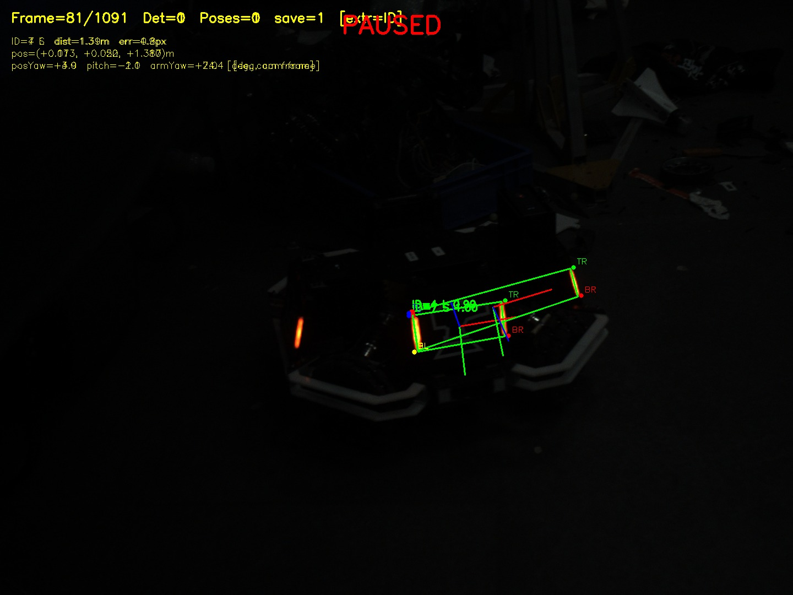
- **机制**：旧循环每轮都"检测 → 把框/角点/坐标轴/PAUSED 字样画进 `frame` → 下一轮再检测
  这张已被画过的图"。**坐标轴红线（x 轴为红色）**、绿框、红字全部灌回下一轮掩码——
  直接制造"假灯条、假 ID、跨中间灯条配对"。
  掩码里能看到被写进去的 UI 字样（可与干净帧掩码对照）：

  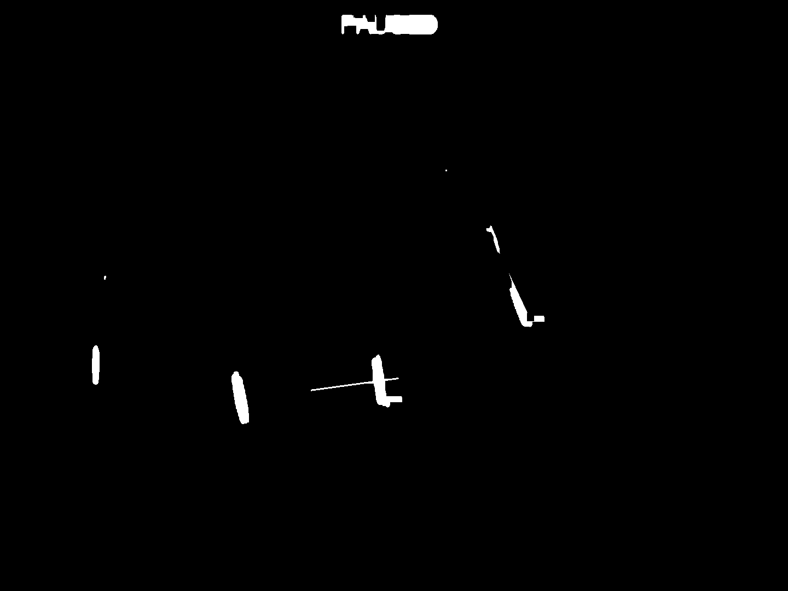
- **修复**：检测/掩码/PnP 只在新帧读入时计算一次并缓存；一切绘制只发生在
  `display_canvas = frame.clone()` 上；原始帧永不回写。
- **教训**：交互式调试工具必须保证"检测只读原始输入"，绘制与数据流彻底隔离。

### 6.2 算法：新增"上下连线应垂直于灯条"条件

- 真实装甲板接近矩形；原条件只保证"上下连线彼此平行"，**挡不住斜切平行四边形**：
  frame 118 干净帧上的假"2"（由两块斜向碎片拼成，PnP 显示 `armYaw=92.6°`、err=5.1px）
  两杆平行、连线平行、比例 2.7 也在合法区间内，全部漏网。
- **新增**（抗滚转写法）：连线相对水平的角度 `|angt|` 与灯条倾角 `|tilt|` 之差 ≤ 25°。
  该假对偏差约 35° 被拒。
- 证据（问题 → 修复后）：

  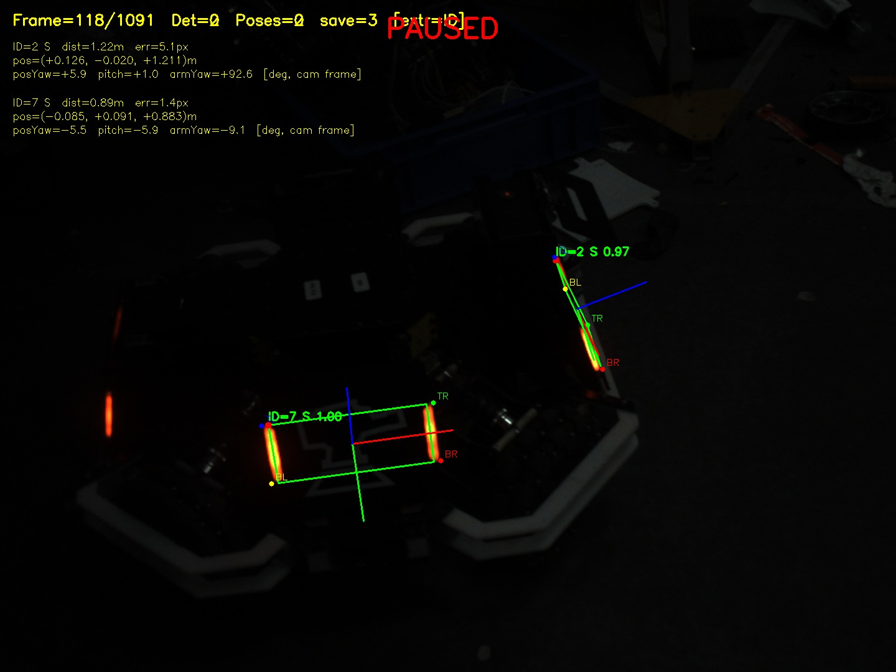

  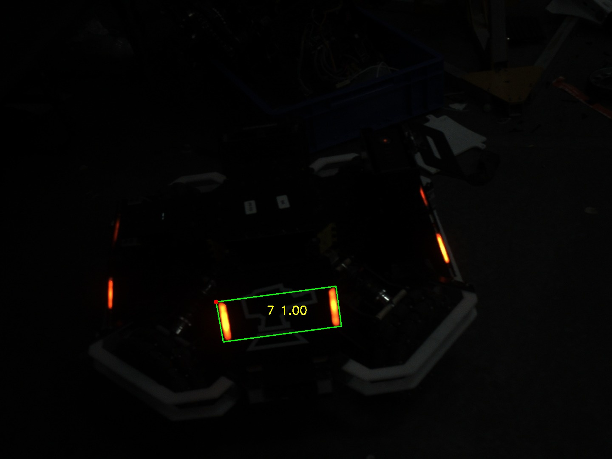

### 6.3 算法：一灯一配消解改为"置信度优先"

- **实测**（f00456/f00477/f00742/f00743）：假候选的裁剪只有 12~35px，被放大到 64×64 后
  "伪装成数字"——分类器给出 "4" 0.996、"8" 0.955、"2" 0.994 的荒谬高置信度；它们与真"7"
  共享灯条冲突时，旧版按"比例偏差"排序会**让假框挤掉真框**（"真板漏、假板出"的直接来源）。
  问题样张（真"7"与假"2"共享中间灯条、两者置信度均高）：

  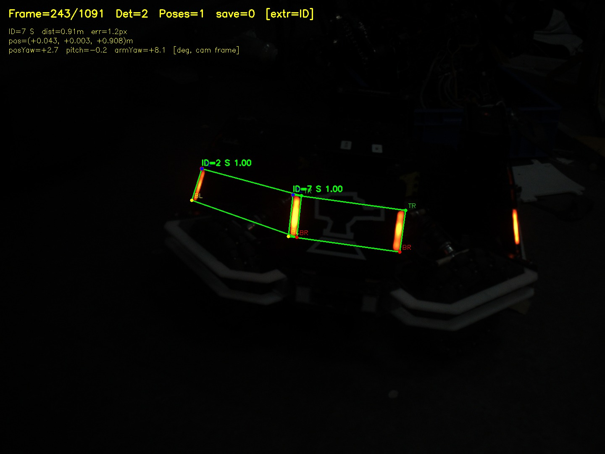
- **修复**：冲突消解按**分类置信度降序**择优（全部实测案例中真"7"置信度 ≈1.0 恒为最高）；
  比例偏差仅作置信度打平后的次序键。**切勿按几何近似度排序**。
- 证据（假框消失 / 误编号恢复为真值 7）：

  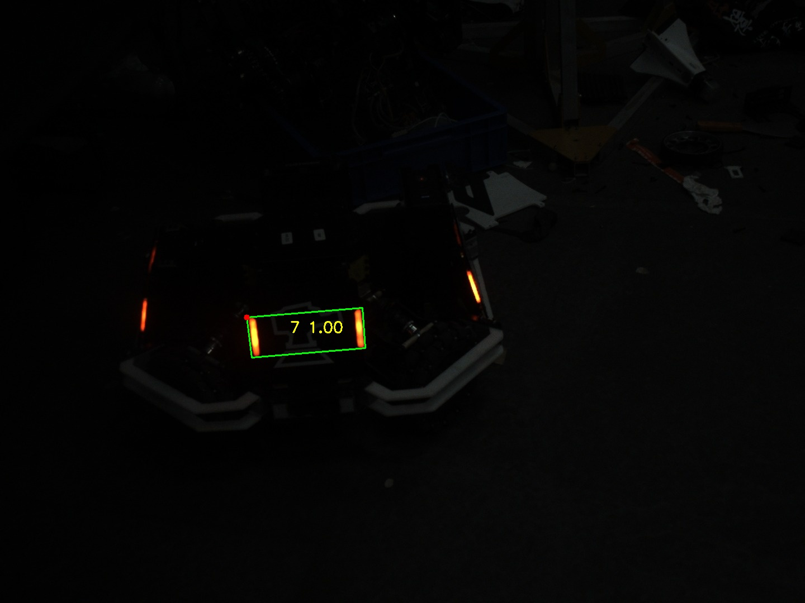

  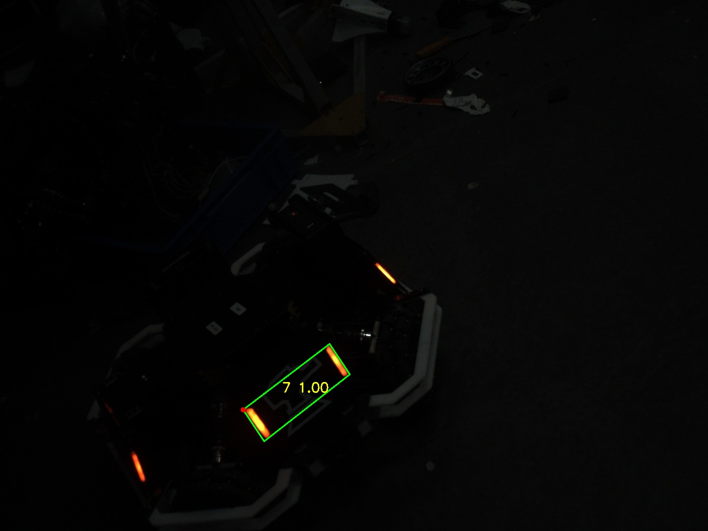

### 6.4 算法：极小裁剪拒绝

- 真数字区域在实测有效距离内最小约 42×80（3360 px）；假碎片则 ≤33×35（1155 px）。
- **新增**：紧贴裁剪后若 面积 < 1200 px 或任一边 < 16 px，直接拒绝（不进入分类器）。

### 6.5 终验结果（全视频 1091 帧，无抽样）

| 指标 | 修复前（抽样 273 帧） | 修复后（全 1091 帧） |
| --- | --- | --- |
| 单检出 det=1 | 211/273（78.8%） | **989/1091（90.7%）** |
| 多检出 det≥2（假框） | 4 | **0** |
| 编号分布 | 混有 id=2/4/8 误识别 | **989 个全为 id=7，零误编号** |
| 断条漏检 | 58 帧 det=0 | 102 帧 det=0（集中在视频首尾/机器人出画/滚到画面角落的段落，抽样确认合理） |
| 合成图回归 | 6/6 | 6/6 |
| ctest | 3/3 | 3/3 |

其他证据——暗灯条断线的帧被 RGB 相减补充救回（正确检出 id=7）、干净帧掩码（与污染版对照）：

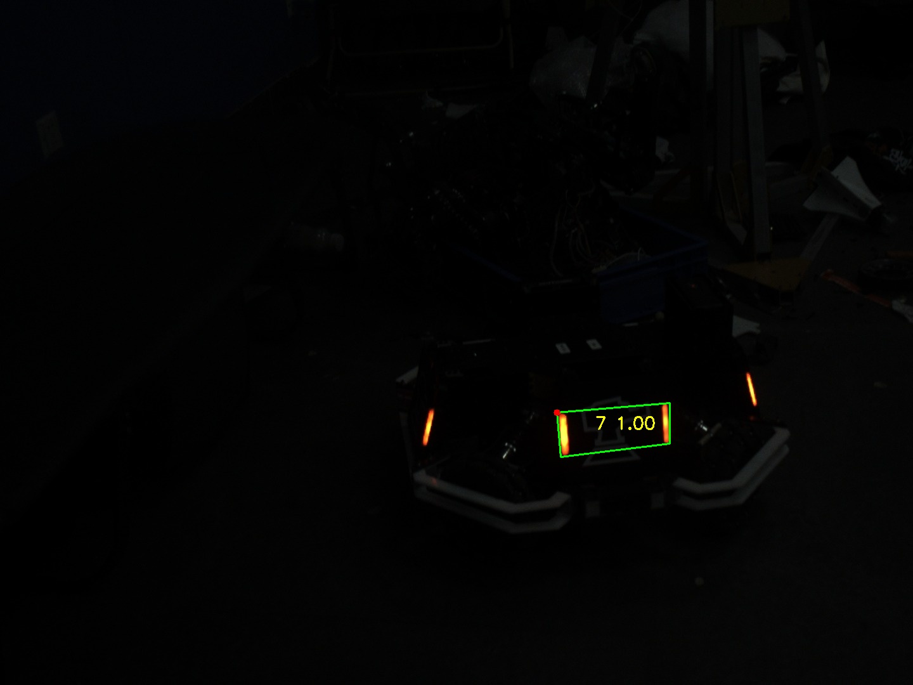

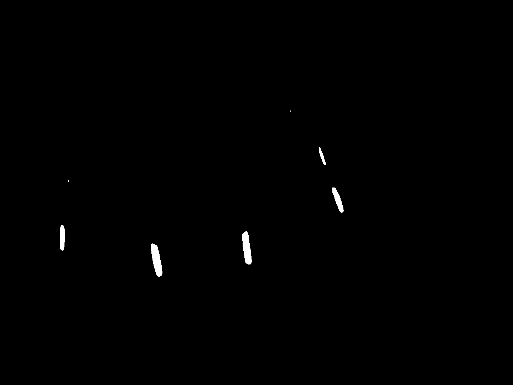

### 6.6 附：平面目标"孪生解"歧义（坐标系蓝轴来回翻转的根因）

回放时发现装甲板坐标系的 **z 轴（蓝色）一会儿朝前一会儿朝后**。定量实验（frame 20 / 565，`solvePnPGeneric` 返回的两个解）：

| 帧 | 解 A（IPPE 默认选中） | 解 B（孪生解） |
| --- | --- | --- |
| frame 20 | err=1.155px，n.y=**−0.449**（蓝轴朝上） | err=1.416px，n.y=+0.459 |
| frame 565 | err=1.695px，n.y=**+0.440**（蓝轴朝下） | err=1.850px，n.y=−0.349 |

- **根因**：平面目标的 IPPE 存在"孪生对"——两个镜像位姿。实测 7 帧：**两解的重投影差仅 0.15~2.3px、位置差 ≤8.5mm，但装甲板 yaw 差 5~50°（典型 10~30°）**。逐帧按"误差小者"独立选择时，亚像素噪声就能让坐标轴与 yaw 来回翻。
- **影响**：瞄准方向与距离由位置决定，两解位置差 <1%（1.4m 处 ≤8.5mm）→ **对"打哪/打多远"几乎无影响**；但 **armor_yaw（车体旋转建模的观测量）会差 10~30°，对后续 EKF 的旋转估计有实际影响**——EKF 阶段需引入消歧（复用 `solveArmorPoseDisambiguated`）或对 yaw 观测加大噪声。
- **修复**（`solveArmorPoseDisambiguated`，测试工具显示专用）：误差差 >3px 时以误差为准；否则取法向与上一帧最接近的解（时域一致，连续帧间真实姿态变化远小于孪生差）；首帧取更接近竖直者。7 帧序列离线验证选择结果稳定。
- `armor_solve` 的 PnP 输出未使用本消歧（其 yaw 抖动留待 EKF 阶段处理）。

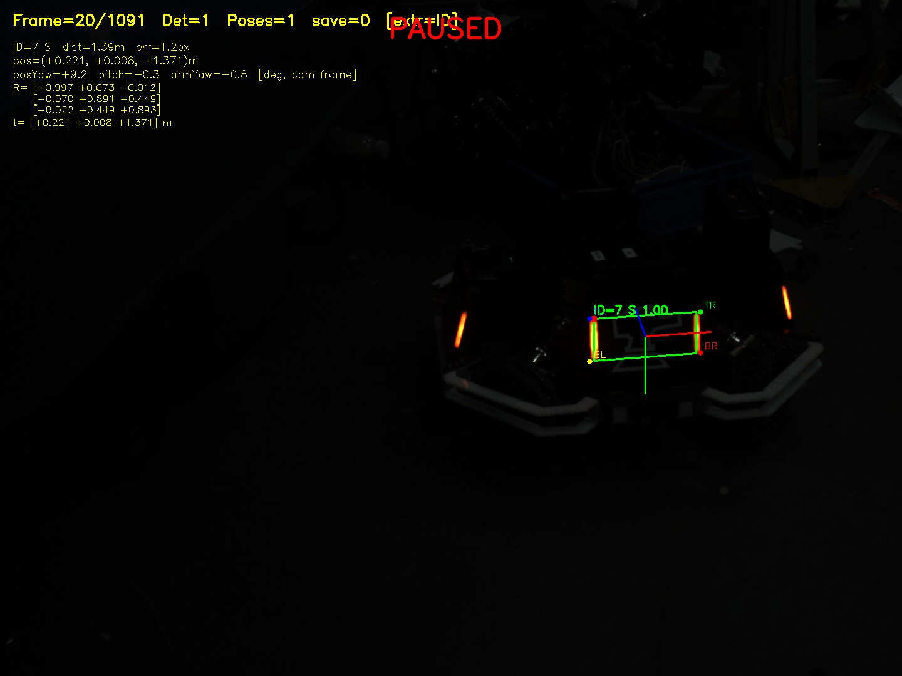

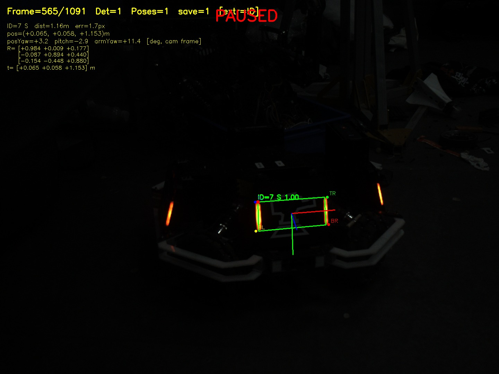

---

## 七、性能与稳定性

- **单帧耗时**：grab≈1.5ms，detect≈4~15ms，pnp≈0.1ms，draw≈3~10ms；
- **总耗时**：约 10~20ms/帧；
- **相机帧率**：30fps（33ms/帧），余量充足；
- **瓶颈**：detect 阶段波动较大（4~19ms），但仍在可接受范围；
- **稳定性**：PnP 门禁阈值 6.0 后，正常批次几乎全过，坏批次可被拒绝。

---

## 八、灯条约束矩形拟合（fitBarConstrained，需求③；2026-10-14）

**背景与基线**：本轮按用户要求，先本地打包备份、再 `git reset --hard` 回退到**最新 push 版本
`cff92c9`**，在该干净基线上实施（基线几何 = 纯 `minAreaRect`）。第四/五轮的未提交工作保留在
项目父目录 `backup_RMVtraining_20261014_132525.tar.gz` 与 `RMVtraining_WIP_round45/`
（patch + 未跟踪文件），可随时恢复。

### 8.1 实现（规格 §3.2/§3.4/§3.5 → 代码）

`student/src/StudentTasks.cpp` 新增 `fitBarConstrained`，对敌方掩码的完整边界点集
（`CHAIN_APPROX_NONE`，规格明确要求）做：

1. **主轴**：边界点集 2×2 协方差主特征向量（闭式解）——方向噪声按 ~1/√N 平均；
2. **局部坐标**：全部点投影到 (u=长向, v=宽向)；
3. **分位定边**：u 取 2%/98%（截端点拖尾）、v 取 10%/90%（截长边缺口/毛刺），
   线性插值分位（numpy.percentile 默认口径）；
4. **接受门**（与 `passesBarFilter` 几何部分同语义）：L ≥ 20px 且 半长/半宽 ≥ 2.5；
5. **质量门**（任一触发回退 `minAreaRect`，不影响检出）：G2 轴偏差 >5°、G3 面积比
   ∉[0.75,1.15]、G1 支撑率 <0.85。

**接线方式（单因素隔离）**：`extractLightBars` 增加第二趟 `CHAIN_APPROX_NONE`
`findContours` 专供拟合（两趟对同一掩码的轮廓顺序一致，按下标配对）；**所有旧路径
（SIMPLE 轮廓、白芯修复、配对/分类）保持逐位不变**——本轮只替换"几何估计器"这一个因素。
回退时原样返回 `minAreaRect` 结果，与旧行为逐位一致。

**开关与钩子**：环境变量 `RMV_BAR_FIT=0`（或 `off`）即回到基线几何；测试钩子
（`g_bar_fit_*` 门控计数与耗时、`debugBars()` 灯条几何转储）供离线度量。

### 8.2 验证工具（`tests/test_bar_fit.cpp`，新增）

```bash
./build/test_bar_fit <视频> [--red|--blue] [--range A B]     # 进程内 A/B（同帧同掩码）
./build/test_bar_fit <视频> --pose [--range A B]              # 位姿统计（变体由 RMV_BAR_FIT 选）
./build/test_bar_fit --synth [--save 前缀]                    # 合成真值对照（可存对照图）
./build/test_bar_fit <视频> --dump-frame N 前缀                # 单帧掩码+灯条转储（跨语言验证用）
python3 tools/verify_fit_constrained.py <掩码> <灯条文件> --counts t,a,pts,size,g1,g2,g3
```

A/B 为**进程内交错**：同一帧、同一掩码下先关后开各跑一次 `armor_detect`，对照严格同源；
灯条级指标只统计**两变体共有的同一物理灯条**（5px 中心匹配，避免拟合多提取的碎条污染尾部），
角点级只统计**各变体内部严格相邻的检出帧**。

**计时口径**：另跑 `--same-variant`（两槽都跑基线）量化"后跑一遍更快"的顺序/缓存偏差：
红静态段 9.68 vs 9.19ms（**偏差 ≈0.5ms/帧**）、蓝 14.00 vs 13.62ms（≈0.4ms/帧）；
真实分辨率（1440×1080）轮廓提取：SIMPLE 0.148ms/次、NONE 0.148ms/次（同价）。
**结论：拟合净增成本 ≈ 拟合本体 0.14ms + 第二趟轮廓 0.15ms ≈ 0.3ms/帧**。

### 8.3 合成真值对照（指标C：有真值才谈"准确性"）

绘制已知几何（L=90px、W=9px、相对竖直 18°）的灯条 + 已知缺陷，跑真实检测链路，
比较两估计器相对**绘制真值**的偏差（锯齿 12 个随机种子，其余 3 个）：

| 场景 | 估计器 | Δ中心 P50/max | Δ方向 P50/max | Δ长边 P50/max | Δ短边 P50/max |
| --- | --- | --- | --- | --- | --- |
| 干净 | minAreaRect | 0.00/0.00 | 0.004/0.004 | 0.49/0.49 | 1.51/1.51 |
| 干净 | **拟合** | 0.01/0.01 | 0.03/0.03 | 0.42/0.42 | **0.47**/0.47 |
| 末端拖尾 8×3px | minAreaRect | 4.10 | 0.004 | 8.69 | 1.51 |
| 末端拖尾 8×3px | **拟合** | **3.40** | 0.15 | **6.82** | **0.36** |
| 侧边光晕 ⌀9px | minAreaRect | 1.81 | 0.004 | 0.49 | 5.12 |
| 侧边光晕 ⌀9px | 拟合 | 1.81 | 0.004 | 0.49 | 5.12（**与基线同值**） |
| 长边锯齿 ±2px | minAreaRect | **0.17**/0.66 | 0.44/1.03 | 0.92/1.23 | 4.91/5.31 |
| 长边锯齿 ±2px | **拟合** | 0.50/1.18 | **0.24/0.49** | **0.23/0.48** | **3.15/3.44** |
| 长边缺口 | minAreaRect | 0.00 | 0.004 | 0.49 | 1.51 |
| 长边缺口 | **拟合** | 0.03 | 0.02 | **0.42** | **0.42** |

要点：① 拟合的宽度/长度对**随机边缘噪声与拖尾更准**（锯齿：Δ长边 0.92→0.23px、Δ方向
0.44→0.24°）；② 干净矩形上拟合的宽度也更贴近真值（掩码比绘制宽 ~1.5px，minAreaRect 取
外沿、拟合落在最外像素中心 → 0.47px）；③ **侧边光晕两者同值**（单侧凸起占周长 >10% 时，
10% 分位分不开两个"平台"）；④ 拟合的**中心**是边界点均值，对不对称凸起比 minAreaRect 稍敏感
（0.17→0.50px）。对照图（白=真值/红=minAreaRect/绿=拟合，5× 放大）：

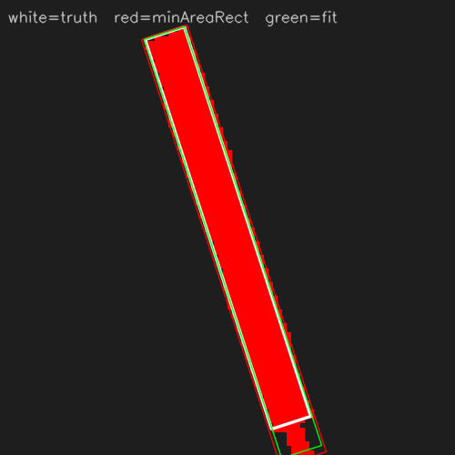

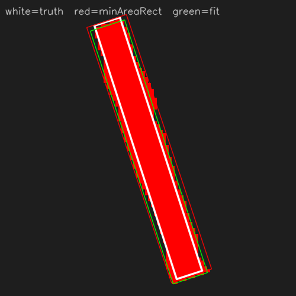

### 8.4 跨语言交叉验证（规格 §3.6 的独立复现）

`tools/verify_fit_constrained.py`（规格 §3.2 的独立 Python 复刻）对同一帧同一掩码逐轮廓复算：

| 帧 | 门控决策（Python vs C++） | 采纳几何逐条对比 |
| --- | --- | --- |
| red 帧 200 | 进入 4 / 采纳 4，逐原因一致 ✓ | Δ中心 ≤2.89e-05 px、Δ半长 ≤1.28e-06、Δ半宽 ≤3.86e-07、Δ轴向 ≤3.81e-05° |
| blue 帧 200 | 进入 6 / 采纳 2 / size=2 / g2=1 / g3=1，逐原因一致 ✓ | Δ中心 ≤3.14e-05 px、Δ半长 ≤1.67e-06、Δ半宽 ≤4.14e-07、Δ轴向 ≤6.54e-05° |

即规格确定、C++ 可复现（差异为 float32/float64 舍入量级，与规格给出的 5.2e-5px 同量级）。

### 8.5 红素材 A/B（`tmp/red.avi`，1895 帧；共有灯条口径）

**检出完全一致：1895/1895 det=1、全 id=7、零假框**（检出规模/编号不一致 0 帧）。

| 指标（帧间变化，P50/P90/P95） | 基线 | 拟合 |
| --- | --- | --- |
| 灯条方向变化 (°) | 0.238 / 0.818 / 1.146 | **0.134 / 0.423 / 0.539** |
| 灯条 Δ半宽 (px) | 0.068 / 0.186 / 0.210 | **0.043 / 0.133 / 0.179** |
| 灯条 Δ半长 (px) | **0.077** / 0.946 / 1.150 | 0.297 / 0.894 / **1.034** |
| 灯条中心位移 (px) | 0.812 / 2.187 / 8.087 | 0.769 / 2.234 / 7.962 |
| 角点每帧最大位移 (px) | 1.879 / 2.734 / 3.777 | **1.434 / 2.393 / 3.210** |
| 角点 TL / BL (px, P50) | 0.879 / 0.848 | **0.681 / 0.740** |
| 角点 TR / BR (px, P50) | **0.587 / 0.594** | 0.932 / 0.908 |

静态段（帧 100–400）同向：方向 0.240→0.143、中心 0.801→0.761、角点最大位移 1.874→1.437px。
每帧灯条数 3.78→4.05（光晕块在拟合几何下更易过 2.5 长宽比）；门控：进入 7765 条、
采纳 96.8%（G2 轴偏差 193、G3 面积比 52）。

**位姿（指标D，1895 帧，poses 1895/1895 全过门禁）**：

| 指标 | 基线 | 拟合 |
| --- | --- | --- |
| armor_yaw 帧间变化 P50/P90/max (°) | 0.591 / 1.725 / 12.57 | **0.360 / 1.009 / 2.18** |
| "独立取误差最小解"法向 >25° 跳变（孪生翻） | 412 次 | **0 次** |
| 消歧路法向 >25° 跳变 | 1 次（帧 2） | **0 次** |
| 坐标系轴端点(8cm)帧间位移 P50/P95 (px) | **0.790** / 2.464 | 0.899 / 2.789 |
| 距离 P50 (mm) | 896.5 | 900.8（**+0.47%**） |
| 重投影误差 P50/P90 (px) | **1.55 / 1.89** | 2.54 / 2.72 |

**关键发现**：拟合的四角形状更"自洽于平面矩形模型"，IPPE 孪生两解的重投影差不再随亚像素
噪声翻号——"逐帧独立取误差最小解"的法向跳变由 **412 次降到 0 次**（消歧路本就接近 0）。
代价：重投影误差中位抬升 ~1px（仍远低于 6px 门禁；**重投影是自洽性指标、不是准确性指标**）；
距离出现 +0.47% 的系统偏移，机制与"拟合四角比 minAreaRect 内收 ~0.8px/边"一致
（135mm 外缘在 900mm 处约 271px，1.6px 收缩 ↔ +0.59%）。

### 8.6 蓝素材 A/B（`tmp/blue.avi`，4227 帧）

> 注意：`blue.avi` 为 2500μs 新曝光素材，**基线（旧色相窗/判据）在其上检出仅 28%**；
> 本节是基线上的相对 A/B，与未提交轮次 §8.10 的收敛口径（99.9%）不可直接比较。

| 指标 | 基线 | 拟合 |
| --- | --- | --- |
| 单检出帧 | 1182（28.0%） | **1405（33.2%）** |
| 编号分布 | id=1:2 2:1 3:9 5:50 **7:1120** | 3:1 5:40 **7:1364**（误编号 62→41，增量全为 id=7） |
| 假框 det≥2 | 0 | 0 |
| 灯条方向变化 P90/P95/max (°) | 2.251 / 3.857 / 14.72 | **0.683 / 1.282 / 11.92** |
| 灯条 Δ半长 P90 (px) | 0.992 | **0.849** |
| 每帧灯条数 | 3.08 | 3.23（门控采纳仅 66.2%：小/远目标多，回退不影响检出） |

**位姿**：poses 987→**1168**（+18%）；平移帧间变化 P50/P90/P95 = 4.96/61.99/81.45 →
**2.93/14.62/20.57 mm**；armor_yaw 台阶（>25°）5→**0**；独立最优解法向跳变 191→**110**；
重投影 P50 2.35→3.15 但 P90 4.40→**3.53**（分布收窄）；距离 908→907mm（无系统偏移）。

### 8.7 失败案例、限制与副作用（数据如实清单）

1. **分位裁剪是"按比例"的**：u 只截 2%——8px 末端拖尾占周长约 9%，拟合只能部分抑制
   （合成 Δ长边 8.69→6.82px，未归零）。实际光晕/拖尾由白芯修复路径兜底。
2. **单侧大凸起（>10% 周长）**：v 的 10%/90% 分位分不开"光晕沿"与"白芯沿"两个平台，
   拟合与 minAreaRect 同值（合成对照无改善）——该场景同样靠白芯修复。
3. **端点中位抖动变差**：Δ半长 P50 0.077→0.297px（红）。minAreaRect 的端点是凸包极值，
   在干净大条上极稳；分位数对局部点密度更敏感。
4. **红素材 TR/BR 角点 P50 变差**（0.59→0.93px）而 TL/BL 变好（0.88→0.68px）：
   与右条光晕更重、宽度在两平台间切换的猜想一致（未单独取证）。
5. **提取灯条数 +7%**（红 3.78→4.05/帧）：光晕块在拟合几何下更易过长宽比门。
   本轮全部检出/编号统计未见假框，但配对候选集变大（EKF 阶段的目标关联需留意）。
6. **重投影误差系统性变化 + 距离 +0.47%（红）**：拟合截掉光晕外沿使"角点↔物点模型
   （135×57 外缘）"的尺度关系改变。若后续 EKF 对距离尺度敏感，需用实测距离复核
   物点模型/角点约定（建议：卷尺实测固定板距离做一次标尺比对）。
7. 本轮只做**单帧**拟合；中心/端点的残余抖动（素材中板子物理运动会贡献 ~0.7px/帧，
   见 §8.12 的运动分离）仍按原结论交由 EKF 时域收口。

### 8.8 结论与验收

- 单帧几何估计器替换的净收益：**灯条方向抖动 −40%~−70%、角点每帧最大位移 P50 −24%
  （红）、孪生解误选跳变 412→0（红）/191→110（蓝）、蓝检出 +19% 且误编号减少**；
  代价：端点中位抖动变差、红 TR/BR 角点变差、灯条数 +7%、重投影中位 +1px、距离 +0.47%（红）。
- **未出现**检出减少、假框增加或门禁拒绝增多的现象（红 poses 不减少、蓝 poses +18%）。
- 回退开关：`RMV_BAR_FIT=0` 一键回基线；实现全部未提交（`git status` 可见），验收后按需提交。
- **验收方式（用户）**：回放对比——`./build/test_camera_playback tmp/red.avi --red` /
  `tmp/blue.avi --blue`（看检测框/坐标轴连续性；本轮算法改动直接影响框与轴）。

### 8.9 二值图"空心/毛糙"的根因与判据恢复（2026-10-14 续；用户验收反馈驱动）

**用户反馈**：回放验收时"检出率很低"、"二值图中间空了"。**定位（数据）**：
`tmp/red.avi` / `tmp/blue.avi` 是 2500μs 新曝光素材，灯条**过曝核心是有色的**
（红条核心 R≈G≈254 呈黄橙 H 20~39；蓝条核心 B≈G≈255 呈青白 H 80~99），而当前基线的
色相窗（红 [0,10]∪[160,180]、蓝 [100,130]）是旧曝光下调的——核心像素整片落在窗外：

| 素材 | 被判据丢掉的"灯条内部像素" | 后果 |
| --- | --- | --- |
| red | 409 px/帧（≈掩码面积 9%） | 条带变薄、四周毛糙（floodFill 只能补**闭合**空洞，补不了边界开口） |
| blue | **1762 px/帧（≈37%）** | 条细/断 → **检出仅 1182/4227（28%）** |

**处理**：恢复此前已验证的曝光适配判据（红色相窗 [0,10]→**[0,40]**、蓝 [100,130]→**[80,130]**、
蓝 V≥80→**60**、蓝 B−G>40→**50**）+ 掩码末尾加 **3×3 多数投票**（边界正则化）。

**结果**：**蓝检出 1182→4226（100%）、全 id=7、零假框**；红保持 1895/1895（100%）；
掩码面积 红 +5% / 蓝 +33%。对照图（左=旧判据，右=恢复后）：

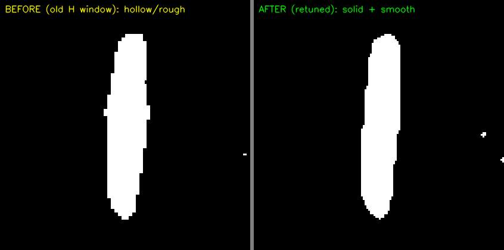

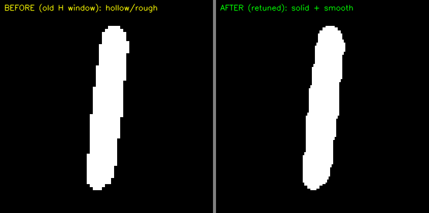

> 风险提示（沿用此前结论）：红窗扩到 [0,40] 后色相上覆盖皮肤色（H 10~25）——由 S/V 与
> 长宽比过滤兜底，现场留意手臂贴近灯条的场景。

### 8.10 四边拟合 v3（默认）——按"检测灯条的四个边"重构；v2 被数据否决

**动机（用户要求）**：不再让几何估计只依赖"整体 PCA + 两个分位点"；二值轮廓在光晕/
过曝下近似椭圆，要求**按灯条的四个边（两条长边 + 两条端边）建模并求交取四角**，以消除
"椭圆化"对宽度/角点的影响。

**v2（两条长边各自独立拟合直线 → 四条边求交）实测否决**：独立线方向经半长（~45px）
力臂放大到角点，且宽度系统性偏小——

| 指标（红，1895 帧） | 基线 | v1 矩形 | v2 独立四边 | **v3 约束四边** |
| --- | --- | --- | --- | --- |
| 灯条方向变化 P95 (°) | 1.515 | **0.335** | 0.500 | 0.378 |
| 灯条 Δ半宽 P95 (px) | 0.207 | **0.121** | 1.103 | 0.135 |
| 角点每帧最大位移 P50 (px) | 1.933 | 1.115 | 1.285 | **1.096** |
| 拟合采纳率 | — | 100% | 90.1%（G3 拒 753） | **100%** |

蓝方 v2 更差：采纳仅 55.7%（G3 拒 4003、E平行 1219）。→ 数据支持任务书的判断：
**四条独立边的自由度超出本素材信噪比时，应采用约束更强的模型**。

**v3（默认）= 保留"四条边"的鲁棒性内核、去掉多余自由度**：
- 两条长边：**方向**由两带 Huber 直线拟合平均（v1 的稳定口径）；**位置**用"该侧全部点
  在法向上的**中位数**"——中位数可容忍该侧 <50% 污染点（v1 的 10%/90% 分位只能容忍 <10%）；
- 两条端边：**⊥ 中轴**的约束形式，位置取沿轴 2%/98% 分位（端盖圆角/光晕不可独立拟合，
  历史 v3 实验已证伪）；
- 四角 = 四条边求交（长边平行约束下即矩形——约束来自数据）。

**门控 G3 同步修订（门控也被数据检验）**：旧口径 `拟合面积/minAreaRect 面积 ∈ [0.75,1.15]`
双向卡——而 minAreaRect 面积**包含光晕/凸起**，正确的修剪反而被拒（合成"侧边光晕/锯齿"
案例 8/22 条全被回退）。改为：solidity = 拟合面积/**掩码实心面积**（contourArea）∈ [0.80,1.30]，
对 minAreaRect 只保留上界 1.15（"变小"是设计目的，"变大"才是异常）。

**合成真值（22 样本全部采纳）**：

| 场景 | 指标 | minAreaRect | v3 |
| --- | --- | --- | --- |
| 侧边光晕 ⌀9px | Δ短边 / Δ中心 | 5.12 / 1.81 px | **0.07 / 0.14 px** |
| 长边锯齿 ±2px | Δ长边 / Δ短边 | 0.92 / 4.91 px | **0.19 / 1.55 px** |
| 末端拖尾 8×3px | Δ长边 / Δ中心 | 8.69 / 4.10 px | **5.95 / 3.39 px**（分位 2% 只能部分抑制） |
| 干净矩形 | Δ短边 | 1.51 px | **0.23 px** |

**视频 A/B（与基线同帧、同掩码）**：

| 指标 | 红 基线 → v3 | 蓝 基线 → v3 |
| --- | --- | --- |
| 检出 | 1895/1895 → **1895/1895（100%）** | 4226/4227 → **4227（100%）** |
| 灯条方向变化 P50 / P90 / P95 (°) | 0.272/0.999/1.515 → **0.100/0.300/0.378** | 0.000/2.255/3.366 → 0.140/**0.720/1.049**（"逐帧冻结再跳"变为小连续量） |
| 灯条 Δ半宽 P50 / P95 (px) | 0.065/0.207 → **0.036/0.135** | 0.063/1.000 → **0.053/0.475** |
| 灯条 Δ半长 P50 / P95 (px) | 0.067/0.954 → 0.212/**0.738** | 0.113/0.849 → 0.151/**0.542** |
| 角点每帧最大位移 P50 / P90 / P95 (px) | 1.933/2.997/3.904 → **1.096/2.091/2.776** | 2.209/5.610/6.813 → **1.405/4.072/6.539** |
| 拟合采纳率（门控） | 100% | 74.1%（接受门 4357=小/远碎块、E平行 1222=不平行碎片；回退不影响检出） |
| 拟合耗时 | 0.62 ms/帧（第二趟 NONE 轮廓 0.21~0.23ms/次） | 同 |

**位姿（指标D）**：

| 指标 | 红 基线 → v3 | 蓝 基线 → v3 |
| --- | --- | --- |
| PnP 平移帧间变化 P50 / P90 (mm) | 1.096/2.693 → **0.539/1.197** | 2.365/7.639 → **1.326/4.230** |
| armor_yaw 帧间变化 P50 / max (°) | 0.774/12.56 → **0.213/1.32** | 0.595/24.5 → **0.503/22.6**（P90 4.36→1.77） |
| "独立取误差最小解"法向 >25° 跳变（孪生翻） | 268 → **0** | 632 → **202** |
| 消歧路法向 >25° 跳变 | 1 → **0** | 50 → **16** |
| 轴端点(8cm)帧间位移 P50 (px) | 0.796 → **0.635** | 0.948 → **0.728** |
| 距离 P50 (mm) / 重投影 P50 (px) | 897.4 → 907.3（**+1.1%**）/ 1.25 → 2.42 | 914.0 → 932.3（**+2.0%**）/ 1.87 → 2.63 |

**副作用（必须知会）**：距离出现系统性偏移（红 +1.1%、蓝 +2.0%），机制 = 拟合宽度落在
最外**像素中心**、比 minAreaRect 的外沿口径小 ~1.6px（合成真值对照支持"拟合宽度更贴近
真实条宽"，但真实距离标尺尚未实测）。重投影中位上升 ~1px（门禁 6px 内、全过；该量是
自洽性指标而非准确性）。**建议**：用卷尺实测固定板距离做一次标尺比对，若确认拟合口径更准，
则物点模型/外参无需更改；否则按实测比例修正。

### 8.11 二值图显示：剔除毛糙、只保留拟合四边形（用户要求的可视化）

新增 `regularizedMaskForDebug`：原始掩码压暗（灰度 70，保留"毛糙"对照）+ 灯条拟合四边形
填满（255）。**回放/实时工具的 mask 窗口默认显示正则化版，按 `k` 键切回原始掩码**；
该显示只服务验收/调试，**不参与主流程**（检测仍用原始掩码，避免"只看见拟合结果"的自证）。

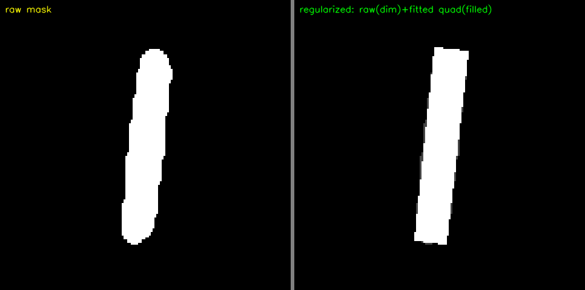

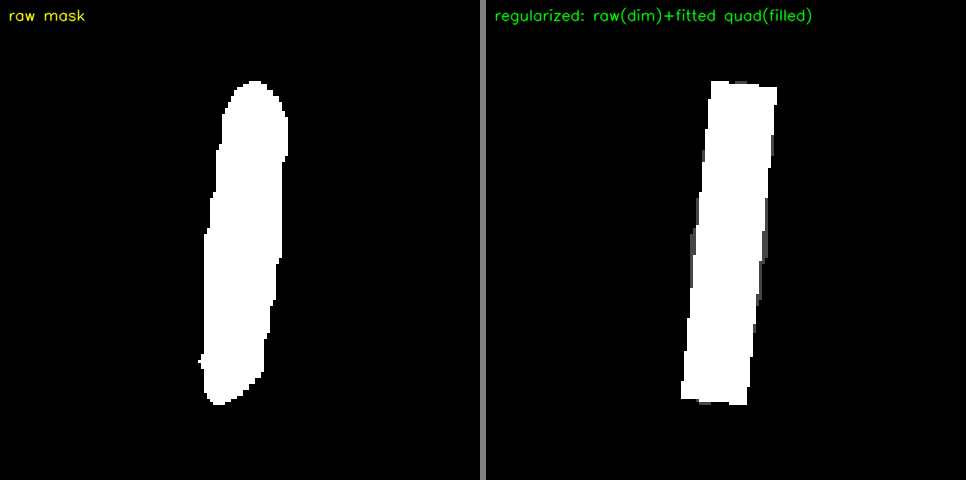

### 8.12 宽度短时域稳健化（P3，2026-10-14；蓝素材"移动后抖动加剧"验收反馈驱动）

**用户反馈**：蓝素材 ~2000 帧后镜头轻移，抖动加剧；"停止后"仍因二值拟合矩形的**粗细一直在
变化**而频繁跳动（并提议"用另一根灯条互相纠正"，自称备选）。

**取证（逐帧复刻掩码管线统计）**：

| 窗口（蓝素材） | 灯条画面漂移 | Δ宽 P50 | Δ宽 P90 | Δ宽>0.5px 占比 |
| --- | --- | --- | --- | --- |
| 100-400（静置） | 0.30 px/帧 | 0.13 | 0.43 | 7% |
| 2000-2250（移动中） | 1.40 px/帧 | 0.22 | 1.04 | 31% |
| 2250-2650（"停止后"） | **1.71 px/帧** | **0.48** | **1.24** | **49%** |

- 用户说"停止后"的段落里，灯条在画面中仍以 ~1.7px/帧 漂移（手持续微动），二值边界**栅格相位**
  持续变化 → 宽度按 ~1px 阶梯振荡 → 角点/框跳动。**根因是二值化量化 + 亚像素相位变化**，不是拟合算错。
- 两根灯条宽度跳变**互不相关**（corr ≈ −0.05~+0.05；同帧双跳 1%/14%），且两棒**合法宽度差可达
  30%**（实测 23.5 vs 18px，透视/远近）→ "互相纠正"只能做异常校验/保持、不能互抄宽度。

**候选预演（先测后选；全部在同一窗口/帧序上做）**：

| 候选 | 最差段 Δ宽 P90 / >0.5px | 合成真值偏差（9px 条） | 裁定 |
| --- | --- | --- | --- |
| 现状（各侧中位数） | 1.24px / 49% | −0.24px（最准） | 问题源 |
| 各侧截尾均值 10% | 0.45px / 6% | **−0.73px（系统偏窄）** | 备选（以准确性换平滑） |
| 面积/长度 | 0.51px / 11% | −0.18px（锯齿 +1.97） | 备选 |
| 灰度亚像素阈值穿越 | 1.73px / 54% | — | **否决**（比现状更差） |
| 窄带均值（锚定中位数） | 1.67px / 52% | — | **否决**（被量化锚定） |
| 跳变>1.2px 保持 | 0.75px / 18%（触发 219/400） | — | **否决**（噪声窗触发过频） |
| **宽度 5 帧中位数窗（采纳）** | **0.37px / 5%** | 无偏（窗口首帧用原始值） | ★采纳 |

**实现（`fitBarConstrained` 之外、只动"宽度"一个参数）**：每根灯条按（中心 ≤15px、长轴 ≤20°）
贪心一对一关联出轨迹，本帧宽度取"本帧 + 最近 ≤5 帧"的**中位数**（窗口内用原始值，避免自反馈）；
新建轨迹 / 间隔 >10 帧（≈0.3s）/ 中心跳 >40px 时重置；只缩放角点在**垂直中轴**方向的分量
（中心/方向/端点不动，不引入跟踪滞后）。开关 `RMV_BAR_WIDTH_WIN=0` 关闭；按拟合模式分表存储，
保证离线 A/B 两个变体互不污染。

**实测（窗口 5 帧 ON vs OFF，同素材同帧序）**：

| 指标 | 蓝全程 4227 帧 | 蓝最差段 2200-2700 | 红全程 1895 帧 |
| --- | --- | --- | --- |
| 灯条 Δ半宽 P50/P90/P95 (px) | 0.053/0.296/0.475 → **0.006/0.073/0.130** | 0.076/0.493/1.131 → **0.007/0.120/0.234** | 0.036/0.107/0.135 → **0.004/0.035/0.051** |
| 角点每帧最大位移 P50/P90/P95 (px) | 1.405/4.072/6.539 → 1.382/4.045/**5.948** | 3.073/12.470/14.900 → **3.013/8.552/10.003** | 1.096/2.091/2.776 → 1.089/2.081/2.790（已稳，无回归） |
| PnP 平移帧间变化 P50/P90/P95 (mm) | 1.326/4.230/6.607 → **1.229/3.621/5.135** | — | — |
| 轴端点帧间位移 P50 (px) | 0.728 → **0.694** | — | — |
| 检出 / 距离 / 重投影 | **零变化**（4227/4227、932.3→932.2mm、2.632→2.634px） | 零变化 | 零变化 |

要点：宽度跳动 **−73%~−79%**；用户抱怨的最差段角点 P90/P95 **−31%/−33%**；**无系统偏窄**
（距离不变）、检出零回归、耗时零增量（无额外图像遍历，只有记账）。残余：个别帧仍有 ~7px 的
单次宽度跳（全程 1 次/501 帧级，归因于轨迹重建或目标姿态变化，未单独取证）。

---

## 九、当前状态

- ✅ 相机取流稳定：断线重连、热插拔、日志分级、退出释放；
- ✅ 相机标定：2 号机内参已入 `config/camera.yaml`（MATLAB，均值误差 0.07px）；外参待提供；
- ✅ 数字分类：模型离线验证完备（去重后 val 100%、ONNX/DNN/ctest 全通过）；
- ✅ 装甲板识别：白芯修复 + RGB 相减补充 + min 通道裁剪 + 形状/极小裁剪检查，
  **全视频 1091 帧零假框、零误编号**（第二轮修复，见第六章）；
- ✅ PnP：门禁阈值经分布统计定为 6.0；实时/回放工具左上角面板常显 编号/尺寸/距离/重投影误差/角度
  + **PnP 的 R/t 矩阵**（R 三行 + t 一行，m 键可打印全精度）；
- ✅ 回放工具：逐帧前进/后退、真实掩码窗口、装甲板坐标系（x红/y绿/z蓝）；实时工具状态栏含**相机帧率 fps**；
- ✅ **灯条约束拟合（需求③，第八章，2026-10-14）**：在 push 基线 `cff92c9` 上实现
  `fitBarConstrained`；默认 **v3 四边约束拟合**（两条长边方向 Huber 平均 + 各侧中位数定宽
  + 端线求交），`RMV_BAR_FIT=0/1/2` 可切基线 / v1 矩形 / v2 独立四边；
- ✅ **曝光适配判据恢复（§8.9）**：新曝光下"核心有色"落在旧色相窗外导致掩码空心/条细——
  恢复红窗 [0,40]、蓝窗 [80,130]、蓝 V≥60/B−G>50 + 3×3 多数投票后，**蓝检出 28%→100%**
  （1182→4226 全 id=7 零假框），红保持 100%；对照图见 `evidence/mask_retune_*.png`；
- ✅ **四边拟合 v3（§8.10）**：红角点每帧最大位移 P50 1.93→**1.10px**、蓝 2.21→**1.41px**；
  方向抖动 P95 红 1.52→0.38°、蓝 3.37→1.05°；孪生误选跳变 红 268→**0**、蓝 632→202；
  平移/ yaw /轴端点位姿抖动全线下降；代价：距离 +1.1%（红）/+2.0%（蓝，待标尺实测复核）、
  重投影中位 +1px（门禁内）；合成真值上"光晕/锯齿"宽度误差 5.12→0.07px；
- ✅ **二值图显示正则化（§8.11）**：mask 窗口默认"原始（暗）+ 拟合四边形（亮）"，k 键切换；
- ✅ **宽度短时域稳健化（§8.12，P3）**：灯条宽度按 5 帧中位数窗（关联+重置，只动宽度参数）——
  蓝素材宽度跳动 −73~79%、用户抱怨的"移动后"最差段角点 P90 12.5→8.6px、平移抖动 −13~22%；
  检出/距离/重投影零回归；`RMV_BAR_WIDTH_WIN=0` 关闭；
- ⚠️ 坏批次重投影误差整体偏高（角点集体变差，成因未明）：排查方向——运动模糊（用 Laplacian 方差和误差做相关性）、板面反光、极端视角、曝光波动；
- 🚧 EKF 尚未开始。

**待办**：需求③ + 判据恢复 + P3 由用户回放视频验收（`test_camera_playback tmp/red.avi --red` /
`tmp/blue.avi --blue`，mask 窗口按 k 对比原始/正则化）后决定是否提交；
动态场景仍未做系统性验证（本轮只覆盖了"轻移后相对静止"的蓝素材段；明显运动/快速逼近下的
宽度窗滞后（~2 帧）未单独实测）；
**距离系统性偏移（红 +1.1%/蓝 +2.0%）建议用卷尺实测距离做一次标尺比对**，再决定是否修正
物点模型/角点口径；外参数值到位后填入 `camera.yaml` 并置 `calibrated: 1`；新相机多样化
场景复测（含双机器人同框；红窗扩至 [0,40] 后留意皮肤/黄色物体）；EKF 模型设计与实现。

---

## 十、经验教训总结

| 类别 | 教训 |
|------|------|
| 资源管理 | 申请/释放成对；状态重置要彻底 |
| 初始化 | 失败要允许重试；日志分级 |
| 阈值 | 按数据分布定（P95/P99），不拍脑袋 |
| 形态学 | 填孔洞用 floodFill，不要无限加核 |
| 过曝 | 白芯是可用特征，不是垃圾 |
| 灰度 | min(B,G,R) 在彩色场景下比 cvtColor 好 |
| 可视化 | 角点画标签，比看数字快 |
| 性能 | 先测数据再优化，不要猜 |
| "假 bug" | 能跑的代码不要随便改，先理解作用 |
| 标定 | 角点"全检出"≠标定好；RMS / 子集拆分 / bootstrap 才是质量指标 |
| 标定 | 覆盖不足时用受限模型是数据结论；更换硬件必须重新标定 |
| 诊断 | 批量失败先做漏斗定位（"配对约束太严"曾被数据否决）|
| 门禁 | 阈值按 P95/P99 定；过宽会放行低质量观测（后续可自适应）|
| 工具 | 交互式调试工具必须"检测只读原始输入"——把绘制结果喂回检测会制造海量假检 |
| 消解 | 冲突择优的排序键用**分类置信度**，不用几何近似度（几何近的假对会挤掉真框）|
| 裁剪 | 极小裁剪（<16px/面积<1200）放大后会被分类器"脑补"成数字，必须前置拒绝 |
| 位姿 | 平面目标 IPPE 存在孪生解歧义（重投影差可 <0.2px）；显示端用时域一致消歧 |
| 估计器 | 极值/凸包类（minAreaRect）"中位稳、尾部跳"，统计类（PCA+分位）"方向噪声 ~1/√N 但会剪掉真实边界"——本案例拟合四角内收 ~0.8px/边 ⇒ 距离 +0.47% 系统偏移（**重投影误差是自洽性、不是准确性**）|
| 分位 | "分位替代极值"有量纲条件：裁剪比例必须大于缺陷占比（8px 拖尾 = 9% 周长 > 2% 裁剪 ⇒ 只能部分抑制）；单侧凸起 >10% 周长时 10% 分位同样失效 |
| 消歧 | 约束拟合（四角自洽于平面矩形模型）会让 IPPE 孪生两解的重投影差**稳定不翻**——"独立取误差最小解"的跳变 412→0（红），孪生歧义可在几何层被大幅削弱，不必全留给 EKF |
| 实验 | 进程内交错 A/B（同帧同掩码）可做最严对照，但必须先量化"运行顺序/缓存"偏差（实测后跑的一遍快 ≈0.4~0.5ms/帧），否则把偏差当算法收益 |
| 统计 | 变体间比较"同一条物理灯条"前要做共有匹配：两变体提取的灯条集合大小会不同（本案例 +7%），全量匹配会把"新增碎条"的抖动算到估计器头上 |
| 验证 | 有权威规格文档的算法，最硬的验证是"C++ 实现 × 规格的独立 Python 复刻逐轮廓对比"：门控决策须逐条一致、几何差应为舍入量级（本案例 ≤3.2e-5px）|
| 判据 | 换曝光/换素材后先核对"窗是否覆盖过曝核心"：过曝核心**是有色的**（红 H20~39、蓝 H80~99），窗没跟上 ⇒ 掩码空心/条细（蓝丢 37% 像素、检出 28%）；floodFill 只能补"闭合"空洞，补不了边界开口 |
| 门控 | 质量门本身要被数据检验：G3 双向面积比 [0.75,1.15] 对 minAreaRect 面积卡下界，会把"正确修剪光晕"的结果拒掉（合成案例 8/22 全回退）——改成 solidity（对掩码实心面积）+ 单侧上界后 22/22 采纳、光晕宽度误差 5.12→0.07px |
| 拟合 | "四个边求交"的自由度要用数据裁：两条长边各自独立拟合在本素材被否决（v2 角点更抖、采纳率掉到 55~90%）；把长边约束为平行（方向共享、位置各取中位数）后同时拿到 v1 的稳定性和对单侧光晕的鲁棒性（v3） |
| 稳健性 | 分位 vs 中位数有量纲条件：分位只容忍裁剪比例内的污染（10% 分位 ↛ 单侧 13% 凸起），中位数容忍该侧 <50%——"选哪种统计量"取决于预期污染占比，不是偏好 |
| 时域 | "参数级"稳健化优先于"显示级"平滑：宽度是缓变量，对其做 5 帧中位数窗（关联+重置+只动该参数）即可把蓝素材宽度跳动压 −75%，且无系统偏窄、无跟踪滞后（中心/方向不参与）；显示级平滑（§8.11 被否决）不解决观测质量，参数级稳健化解决 |
| 取证 | "抖动"先分清"目标真在动 vs 量化噪"：蓝"停止后"段灯条仍以 1.7px/帧 漂移，二值边界栅格相位变化 → 宽度 1px 阶梯振荡（>0.5px 跳占 49%）——先量漂移再谈算法 |
| 直觉 | "双灯条互相纠正"被数据限定：两棒宽度跳变独立（corr≈0，可用于校验），但绝对宽度合法差 30%（透视）——互相"抄"宽度会引入错误，只能做异常检测/保持 |
